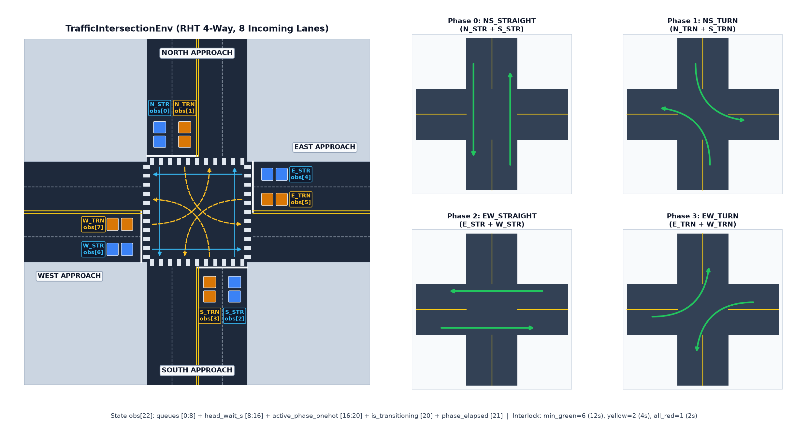
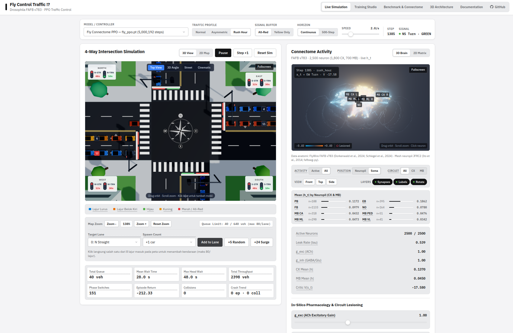
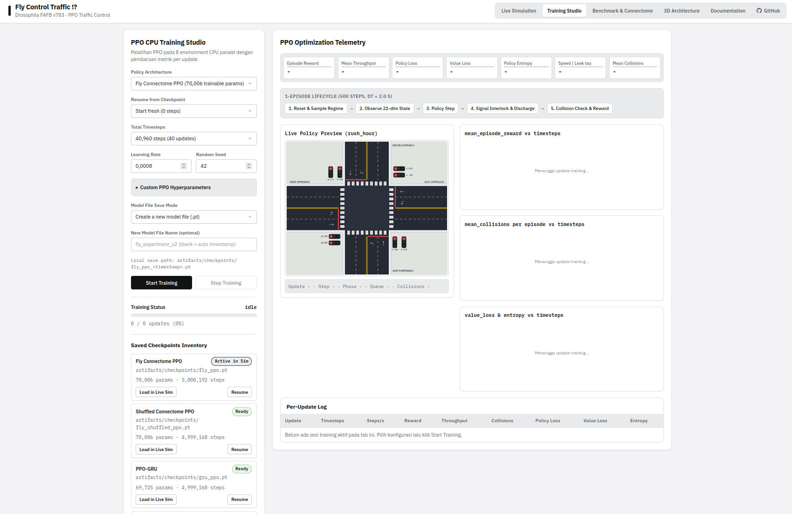
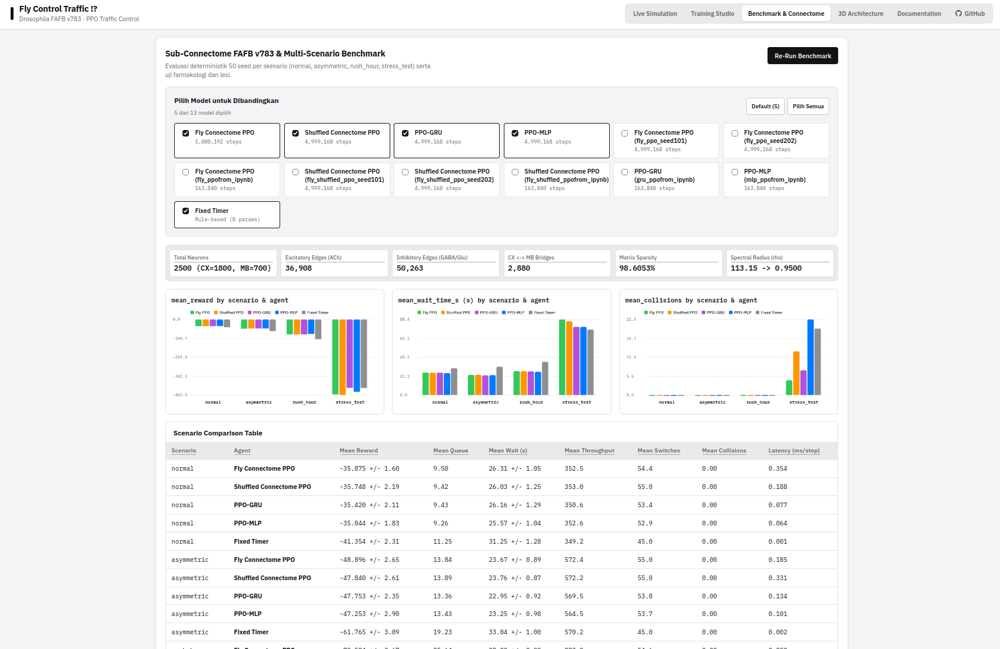
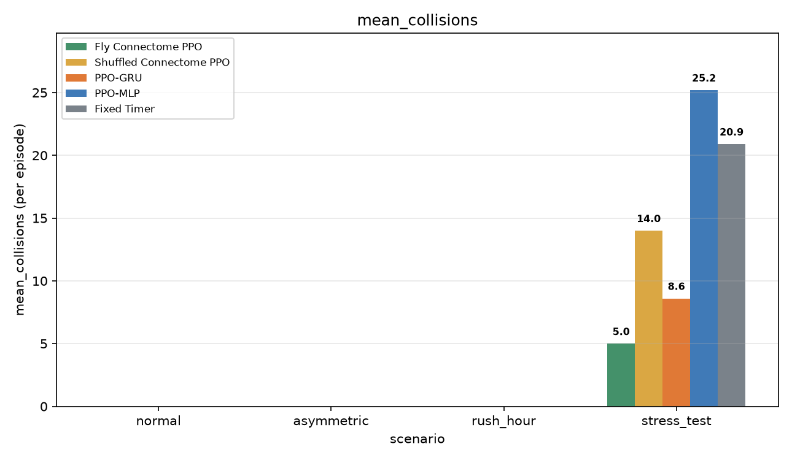
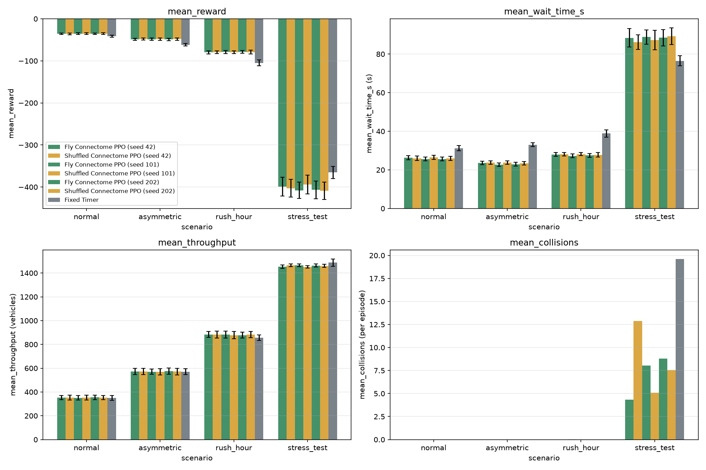
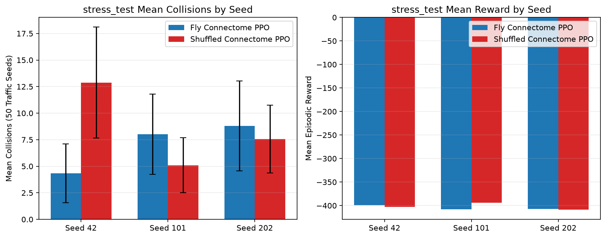

# Can a Fly Control Traffic?

Pengujian kelayakan sub-konektom otak lalat buah (*Drosophila melanogaster*, dataset `FlyWire FAFB v783`) sebagai inti rekuren pada kebijakan pengendalian lampu lalu lintas persimpangan empat arah berbasis *Proximal Policy Optimization* (PPO), berjalan 100% di CPU.

Proyek ini merumuskan **uji kapabilitas (*capability study*)** dengan pola **Biological Reservoir Computing**: matriks sinaptik asli dari **2.500 neuron** sirkuit **Central Complex (`PB`, `FB`, `EB`, `NO`)** dan **Mushroom Body (`MB_*`)** (`87.171` sisi berpolaritas eksitatori `ACH` dan inhibitori `GABA`/`GLUT`, *sparsity* `98,61%`) dibekukan (*frozen*, `requires_grad=False`), sementara PPO melatih tepat **`70.006` parameter adapter** (`input_projection`, `tau_logit`, `actor_head`, dan `critic_head`).



---

## Fitur Utama & Artefak Siap Pakai

Repositori ini menyertakan sub-konektom hasil ekstraksi (`artifacts/fly_subconnectome.pt`, `artifacts/fly_subconnectome_shuffled.pt`), **4 checkpoint model final (~5 juta langkah latih)** di `artifacts/checkpoints/{fly,fly_shuffled,gru,mlp}_ppo.pt`, serta laporan benchmark terverifikasi di `artifacts/benchmarks/`. Anda dapat langsung menjalankan Web Lab interaktif maupun evaluasi tanpa perlu mengunduh dataset mentah `dataset/` (`>333 MiB`).

- **Web Lab Interaktif (`http://127.0.0.1:8080`)**:
  - **Live Simulation (`/simulation`)**: Simulasi **3D View** Three.js (`Top View`, `3D Angle`, `Street`, `Cinematic`, `OrbitControls`, HUD sinyal per arah) dan sakelar **2D Map**, injeksi kendaraan manual per lajur, visualisasi **3D Brain** FlyWire (`2.500` neuron CX/MB + pulsa sinapsis), slider farmakologi $g_{\text{exc}}$ / $g_{\text{inh}}$ *real-time*, serta lesi sirkuit *in-silico*.
  - **Training Studio (`/training`)**: Pelatihan PPO 8 environment CPU paralel (`fly`, `fly_shuffled`, `gru`, `mlp`), fitur *resume checkpoint*, kustomisasi hyperparameter, dan **Live Policy Preview** via WebSocket.
  - **Benchmark & Connectome (`/benchmark`)**: Evaluasi deterministik multi-skenario langsung dari antarmuka web, ringkasan statistik graf `FAFB v783`, serta tabel uji farmakologi dan lesi.
  - **3D Architecture (`/architecture`) & Documentation (`/docs`)**: Eksplorasi 3D aliran *Forward Pass* vs *Backward Gradient* pada `FlyConnectomePolicy` dan laporan teknis interaktif.

| Live Simulation & 3D Fly Brain (`/simulation`) | Training Studio & Live Policy Preview (`/training`) |
|:---:|:---:|
|  |  |
| **Benchmark & Connectome Analytics (`/benchmark`)** | **3D Interactive Architecture (`/architecture`)** |
|  |  |

---

## Instalasi & Cara Menjalankan

Memerlukan Python `>= 3.11`. Instalasi paket dapat menggunakan [`uv`](https://docs.astral.sh/uv/) (indeks PyTorch CPU sudah dikonfigurasi di `pyproject.toml`) atau `pip` di dalam *virtual environment* aktif:

```bash
# 1. Buat dan aktifkan virtual environment
uv venv .venv
source .venv/bin/activate   # Windows: .venv\Scripts\activate

# 2. Instal dependensi inti (CPU-only PyTorch) dalam mode editable
uv pip install -e .

# Opsional: sertakan paket ekstraksi CSV/3D, Pygame sandbox, & pytest
uv pip install -e ".[all]"
```

### 1. Menjalankan Web Lab Utama (Direkomendasikan)

```bash
python scripts/launch_web_lab.py --host 127.0.0.1 --port 8080
```

Buka `http://127.0.0.1:8080` di browser. Untuk menjalankan penampil 3D simpang secara terpisah tanpa panel penuh:

```bash
python simulation3d/serve.py --host 127.0.0.1 --port 8888
```

### 2. Perintah CLI & Notebook (Training, Benchmark, Pengujian)

```bash
# Evaluasi komparatif 5 pengendali pada 4 skenario (50 seed, 500 langkah/episode)
python scripts/run_benchmark.py

# Latih kebijakan PPO dari CLI (mendukung --resume dan --parallel-models 1|2|4)
python scripts/train_agents.py --agents fly fly_shuffled mlp gru --total-timesteps 163840 --suffix "_custom"

# Jalankan seluruh unit & integration tests
pytest tests/ -q

# Opsional: ekstrak ulang sub-connectome bila menyediakan dataset/connections_princeton.csv
# python scripts/extract_connectome.py
```

Eksplorasi pelatihan interaktif (lokal maupun Google Colab) tersedia di [`notebooks/train_agents.ipynb`](notebooks/train_agents.ipynb) (4 agen utama) dan [`notebooks/train_fly_vs_shuffled_multiseed.ipynb`](notebooks/train_fly_vs_shuffled_multiseed.ipynb) (replikasi multi-seed `Fly` vs `Shuffled`).

---

## Desain Pengendali & Kontrol Ilmiah

Untuk menguji apakah topologi biologis memberikan kontribusi nyata dibanding sekadar proyeksi rekuren berdimensi tinggi atau jaringan standar, kelima pengendali diuji pada anggaran parameter terlatih yang sebanding (~70 ribu parameter) di lingkungan yang identik (`max_steps = 500` / `1.000 s`, `min_green_steps = 6`, `yellow_steps = 2`, `all_red_steps = 1`, `collision_penalty = 80.0`):

| Pengendali | Kelas / Modul | Memori Rekuren | Parameter Terlatih | Peran Pembanding |
|---|---|---|---:|---|
| **Fly Connectome PPO** (`fly`) | `FlyConnectomePolicy` | `2.500` neuron *sparse* FAFB v783 (*frozen* $W_{\text{exc}}, W_{\text{inh}}$) | `70.006` | Model utama berbasis sub-konektom biologis asli (`1.800` CX + `700` MB, `2.880` sisi lintas wilayah). |
| **Shuffled Connectome PPO** (`fly_shuffled`) | `FlyConnectomePolicy` + `shuffled.py` | `2.500` neuron *sparse* teracak (*frozen*) | `70.006` | *Null model* (*global random edge rewiring*): mempertahankan jumlah sisi, distribusi bobot E/I, *sparsity* `98,61%`, dan *spectral radius* `0,95`, tetapi mengacak topologi modular (`35.430` sisi lintas wilayah). |
| **PPO-GRU** (`gru`) | `GRUBaselinePolicy` | `105` unit GRU terlatih penuh | `69.725` | Pembanding *end-to-end* rekuren artifisial standar. |
| **PPO-MLP** (`mlp`) | `MLPBaselinePolicy` | Tidak ada (2 lapis `Tanh`, lebar `250`) | `69.755` | Pembanding *feedforward* reaktif tanpa memori internal. |
| **Fixed Timer** (`fixed_timer`) | `FixedTimerAgent` | Tidak ada (aturan siklik `(10, 6, 10, 6)` langkah) | `0` | Baseline non-AI berjadwal waktu hijau tetap (`20s-12s-20s-12s`). |

### Invarian Statistik *Fly Connectome* vs *Shuffled Null Model*

| Properti Graf | Fly Connectome (`fly_subconnectome.pt`) | Shuffled Connectome (`fly_subconnectome_shuffled.pt`) | Keterangan |
|---|---|---|---|
| **Jumlah Neuron (`CX + MB`)** | `2.500` (`1.800` + `700`) | `2.500` (`1.800` + `700`) | Identik |
| **Sisi Eksitatori / Inhibitori** | `36.908` / `50.263` | `36.908` / `50.263` | Jumlah sisi & himpunan bobot identik, pasangan `(post, pre)` diacak |
| **Kejarangan (*Sparsity*)** | `98,6053%` | `98,6053%` | Identik (`87.171` sisi aktif dari `6.250.000` pasangan) |
| **Koneksi Lintas Wilayah (`CX <-> MB`)** | `2.880` sisi | `35.430` sisi | Modularitas biologis hancur pada *null model* |
| ***Raw* -> *Scaled Spectral Radius*** | `113,1494` -> `0,9500` | `0,1302` -> `0,9500` | Sama-sama dinormalisasi ke `0,95` sebelum dibekukan |

---

## Hasil Benchmark (~5 Juta Langkah Latih, 50 Seed per Skenario)

Tabel di bawah disinkronkan langsung dari [`artifacts/benchmarks/benchmark_table.md`](artifacts/benchmarks/benchmark_table.md) (`500` langkah / episode, `seed = 1000..1049`):

| Skenario | Agen | Parameter Terlatih | Mean Reward | Mean Queue | Mean Wait (s) | Mean Throughput | Mean Switches | Mean Collisions | Latency (ms/step) |
|---|---|---:|---:|---:|---:|---:|---:|---:|---:|
| `normal` | Fly Connectome PPO | 70.006 | -35.875 | 9.50 | 26.31 | 352.5 | 54.4 | 0.00 | 0.354 |
| `normal` | Shuffled Connectome PPO | 70.006 | -35.748 | 9.42 | 26.03 | 353.0 | 55.0 | 0.00 | 0.188 |
| `normal` | PPO-GRU | 69.725 | -35.420 | 9.43 | 26.16 | 350.6 | 53.4 | 0.00 | 0.077 |
| `normal` | PPO-MLP | 69.755 | -35.044 | 9.26 | 25.57 | 352.6 | 52.9 | 0.00 | 0.064 |
| `normal` | Fixed Timer (`10-6-10-6`) | 0 | -41.354 | 11.25 | 31.25 | 349.2 | 45.0 | 0.00 | 0.001 |
| `asymmetric` | Fly Connectome PPO | 70.006 | -48.896 | 13.84 | 23.67 | 572.4 | 55.0 | 0.00 | 0.185 |
| `asymmetric` | Shuffled Connectome PPO | 70.006 | -47.840 | 13.89 | 23.76 | 572.2 | 55.0 | 0.00 | 0.331 |
| `asymmetric` | PPO-GRU | 69.725 | -47.753 | 13.36 | 22.95 | 569.5 | 53.8 | 0.00 | 0.134 |
| `asymmetric` | PPO-MLP | 69.755 | -47.253 | 13.43 | 23.25 | 564.5 | 53.7 | 0.00 | 0.101 |
| `asymmetric` | Fixed Timer (`10-6-10-6`) | 0 | -61.765 | 19.23 | 33.04 | 570.2 | 45.0 | 0.00 | 0.002 |
| `rush_hour` | Fly Connectome PPO | 70.006 | -79.584 | 25.64 | 28.00 | 883.9 | 54.6 | 0.00 | 0.292 |
| `rush_hour` | Shuffled Connectome PPO | 70.006 | -79.682 | 25.65 | 28.08 | 882.2 | 54.3 | 0.00 | 0.308 |
| `rush_hour` | PPO-GRU | 69.725 | -79.077 | 25.40 | 27.74 | 884.8 | 54.0 | 0.00 | 0.122 |
| `rush_hour` | PPO-MLP | 69.755 | -77.132 | 24.71 | 27.13 | 880.2 | 53.6 | 0.00 | 0.093 |
| `rush_hour` | Fixed Timer (`10-6-10-6`) | 0 | -104.975 | 35.55 | 38.86 | 856.2 | 45.0 | 0.00 | 0.002 |
| `stress_test` | Fly Connectome PPO | 70.006 | -399.310 | 145.34 | 88.43 | 1452.1 | 55.0 | 4.34 | 0.321 |
| `stress_test` | Shuffled Connectome PPO | 70.006 | -402.899 | 143.22 | 86.22 | 1465.1 | 55.0 | 12.88 | 0.283 |
| `stress_test` | PPO-GRU | 69.725 | -364.830 | 130.93 | 79.85 | 1469.5 | 52.5 | 7.32 | 0.120 |
| `stress_test` | PPO-MLP | 69.755 | -385.239 | 133.12 | 79.81 | 1483.3 | 53.8 | 22.32 | 0.099 |
| `stress_test` | Fixed Timer (`10-6-10-6`) | 0 | -365.494 | 126.59 | 76.51 | 1487.1 | 45.0 | 19.62 | 0.002 |

### Uji Konsistensi Multi-Seed: `Fly Connectome PPO` vs `Shuffled Connectome PPO` (`3` Seed × `50` Seed Trafik)

Untuk memeriksa apakah perbedaan pada `seed 42` bersifat konsisten terhadap variasi inisialisasi pelatihan dan realisasi pengacakan graf, kedua model reservoir (`Fly` dan `Shuffled`) dilatih ulang penuh (`~5M` langkah) pada 2 seed independen tambahan (`seed 101` dan `seed 202`, masing-masing dengan graf acak terpisah `fly_subconnectome_shuffled_seed{101,202}.pt`) dan dievaluasi pada `50` seed trafik (`1000..1049`; total `150` episode per skenario per arsitektur, sumber: [`artifacts/benchmarks/multiseed_fly_vs_shuffled/multiseed_table.md`](artifacts/benchmarks/multiseed_fly_vs_shuffled/multiseed_table.md)):

| Seed Latih / Rewiring | `Fly` Collisions (`stress_test`) | `Shuffled` Collisions (`stress_test`) | `Fly < Shuffled` (dari 50) | `Fly` Reward | `Shuffled` Reward |
|---:|---:|---:|---:|---:|---:|
| `42` | `4.34 ± 2.77` (`med 4.0`) | `12.88 ± 5.23` (`med 13.0`) | `46/50` (`92%`) | `-399.310` | `-402.899` |
| `101` | `8.02 ± 3.79` (`med 8.0`) | `5.10 ± 2.59` (`med 5.0`) | `8/50` (`16%`) | `-407.856` | `-393.939` |
| `202` | `8.80 ± 4.23` (`med 8.0`) | `7.56 ± 3.20` (`med 7.0`) | `21/50` (`42%`) | `-406.843` | `-408.854` |
| **Agregat (`N = 3` Seed)** | **`7.05 ± 1.94`** | **`8.51 ± 3.25`** | **`75/150` (`50.0%`)** | **`-404.670 ± 3.812`** | **`-401.897 ± 6.130`** |

Pada skenario non-jenuh lintas `N = 3` seed, keduanya tetap sejajar (`normal`: `-35.553 ± 0.233` vs `-35.559 ± 0.135`; `asymmetric`: `-48.880 ± 0.224` vs `-48.100 ± 0.204`; `rush_hour`: `-78.960 ± 0.456` vs `-79.342 ± 0.242`).

### Ringkasan Temuan Faktual

1. **Rezim Non-Jenuh (`normal`, `asymmetric`, `rush_hour`)**: Seluruh kebijakan RL mengungguli `Fixed Timer` secara konsisten di seluruh seed evaluasi maupun replikasi latih (pada `rush_hour`, waktu tunggu rata-rata turun dari `38.86 s` menjadi `27.13–28.08 s` dengan `0.00` kolisi pada evaluasi 5 agen dan `<= 0.01` kolisi pada agregat 3 seed).
2. **Isolasi `Fly Connectome` vs `Shuffled Null Model` (Multi-Seed `N = 3`)**: Meskipun pada `seed 42` `Fly Connectome PPO` mencatat kolisi lebih rendah (`4.34` vs `12.88`; `46/50` seed trafik), arah selisih tersebut berbalik pada `seed 101` (`8.02` vs `5.10`; `8/50`) dan `seed 202` (`8.80` vs `7.56`; `21/50`). Secara agregat `N = 3`, rentang kolisi (`7.05 ± 1.94` vs `8.51 ± 3.25`) dan return (`-404.670 ± 3.812` vs `-401.897 ± 6.130`) saling tumpang tindih dengan rasio kemenangan berpasangan `75/150` (`50.0%`). Berdasarkan data 3 seed saat ini, **belum terdapat bukti statistik yang cukup untuk menyimpulkan apakah topologi biologis `CX`/`MB` memberikan keunggulan konsisten dibandingkan reservoir acak terkalibrasi spektral (`ρ = 0.95`)** pada lingkungan simpang ini.
3. **Rezim Saturasi Lintas Arsitektur (`stress_test`, `seed 42`)**: `PPO-GRU` meraih `Mean Reward` tertinggi (`-364.830`, melampaui `Fixed Timer` `-365.494` dengan `7.32` kolisi), sedangkan `PPO-MLP` mencatat kolisi tertinggi (`22.32`). Kedua reservoir beku (`Fly` dan `Shuffled`) mempertahankan rotasi fase reguler (`~55.0` switch) dengan antrean rata-rata lebih tinggi dibanding `PPO-GRU`.
4. **Perturbasi Farmakologi, Lesi Sirkuit, & Komputasi CPU**: Variasi pengali sinaptik (`g_exc = 1.8`, `g_inh = 0.2` atau `2.0`) serta lesi `25%` neuron CX, MB, maupun acak mempertahankan `0.00` kolisi pada `rush_hour` (`Mean Reward` `-79.584` hingga `-78.689`), dengan biaya inferensi matriks *sparse* CPU sebesar `0.185–0.354 ms/step` dibanding `0.064–0.134 ms/step` pada `PPO-MLP` dan `PPO-GRU`.








Figur evaluasi lengkap lainnya tersedia di `artifacts/benchmarks/`: [scenario_comparison.png](artifacts/benchmarks/scenario_comparison.png), [fly_vs_shuffled_comparison.png](artifacts/benchmarks/fly_vs_shuffled_comparison.png), [training_curves.png](artifacts/benchmarks/training_curves.png), [training_curves_multiseed.png](artifacts/benchmarks/multiseed_fly_vs_shuffled/training_curves_multiseed.png), [pharmacology_ablation.png](artifacts/benchmarks/pharmacology_ablation.png), [experiment_evolution_comparison.png](artifacts/benchmarks/experiment_evolution_comparison.png), dan ringkasan replikasi 3 seed [`multiseed_table.md`](artifacts/benchmarks/multiseed_fly_vs_shuffled/multiseed_table.md).

---

## Struktur Direktori

```text
.
├── artifacts/                      # Sub-connectome (.pt), 4 checkpoint PPO (~5M), & laporan benchmark
│   ├── fly_subconnectome.pt
│   ├── fly_subconnectome_shuffled.pt
│   ├── checkpoints/                # fly_ppo.pt, fly_shuffled_ppo.pt, gru_ppo.pt, mlp_ppo.pt
│   └── benchmarks/                 # JSON, tabel Markdown, & grafik hasil evaluasi
├── docs/                           # Dokumentasi berjenjang (lihat docs/README.md)
│   ├── README.md                   # Indeks navigasi dokumentasi
│   ├── technical_report.pdf        # Technical report
│   ├── TRAINING_AND_EPISODE_GUIDE.md
│   ├── VARIABLES_AND_MATH.md
│   ├── config.md
│   ├── src/                        # Referensi teknis per submodul backend
│   └── scripts/                    # Referensi CLI & notebook
├── frontend/                       # SPA Web Lab (HTML Partials, CSS, Canvas 2D, Three.js)
│   ├── assets/brain/               # Mesh anatomi 3D (.glb) & koordinat soma neuron
│   ├── partials/                   # Panel simulation, training, benchmark, architecture, docs
│   ├── js/                         # Controller UI & modul bersama 3D simpang (js/sim3d/)
│   └── vendor/three/               # Pustaka Three.js lokal tanpa ketergantungan CDN
├── notebooks/
│   ├── train_agents.ipynb                     # Notebook interaktif training & benchmark 4 agen
│   └── train_fly_vs_shuffled_multiseed.ipynb  # Notebook replikasi 3 seed (Fly vs Shuffled)
├── scripts/                        # Entrypoint CLI (extract, build_brain_assets, train, benchmark, web)
├── simulation3d/                   # Server penampil 3D simpang mandiri (port 8888)
├── src/fly_traffic/                # Paket Python utama
│   ├── config.py                   # 5 frozen dataclass konfigurasi terpusat
│   ├── connectome/                 # Ekstraksi CSV Polars, shuffled null model, & aset otak 3D
│   ├── environment/                # TrafficIntersectionEnv (Gymnasium), interlock, & profil Poisson
│   ├── agents/                     # ConnectomeRecurrentCell, Fly/MLP/GRU policies, FixedTimer
│   ├── training/                   # RecurrentRolloutBuffer & sequence-chunked PPOTrainer
│   ├── evaluation/                 # AgentEvaluator & BenchmarkPlotter
│   ├── web/                        # Server aiohttp/WebSocket, SimulationService, TrainingJobManager
│   └── ui/                         # Aplikasi desktop Pygame opsional
├── tests/                          # Unit & integration tests (pytest)
├── pyproject.toml
└── uv.lock
```

---

## Dokumentasi Lanjutan

Mulai dari [Indeks Dokumentasi (`docs/README.md`)](docs/README.md):
1. **[Technical Report (`docs/technical_report.pdf`)](docs/technical_report.pdf)** — Metodologi ekstraksi konektom, spesifikasi lingkungan dan mekanisme kolisi, arsitektur kebijakan, hasil evaluasi, serta batasan studi.
2. **[Panduan Siklus Episode & Loop PPO (`docs/TRAINING_AND_EPISODE_GUIDE.md`)](docs/TRAINING_AND_EPISODE_GUIDE.md)** — Alur data sistem, anatomi 1 episode `500` langkah, *decision masking*, dan *Live Policy Preview*.
3. **[Referensi Kode & Matematika](docs/VARIABLES_AND_MATH.md)** — Kamus simbol persamaan, [Referensi Konfigurasi](docs/config.md), [Referensi Submodul Backend](docs/src/README.md), dan [Referensi Skrip CLI](docs/scripts/cli.md).

---

## Sumber Dataset & Referensi

Berkas mentah (`dataset/`, `>333 MiB`) dikecualikan dari Git karena sudah dikemas menjadi matriks sparse siap pakai di `artifacts/fly_subconnectome*.pt` dan aset 3D di `frontend/assets/brain/`. Sumber data asli dapat diakses melalui:

1. **FlyWire FAFB v783 Whole-Brain Connectome (`connections_princeton.csv`):** [codex.flywire.ai](https://codex.flywire.ai) — Dorkenwald, S., Matsliah, A., Yu, S.-C., et al. (2024). *Neuronal wiring diagram of an adult brain.* Nature, 634, 124–138. [doi:10.1038/s41586-024-07558-y](https://doi.org/10.1038/s41586-024-07558-y)
2. **Prediksi Neurotransmiter Sinaptik (`ACH`, `GABA`, `GLUT`):** Eckstein, N., Bates, A. S., Champion, A., et al. (2024). *Neurotransmitter classification from electron microscopy images at synaptic sites in Drosophila melanogaster.* Cell, 187(10), 2574–2594. [doi:10.1016/j.cell.2024.03.016](https://doi.org/10.1016/j.cell.2024.03.016)
3. **Anotasi Neuron & Koordinat Soma (`neuron_annotations.tsv`):** [flyconnectome/flywire_annotations](https://github.com/flyconnectome/flywire_annotations) — Schlegel, P., Yin, Y., Bates, A. S., et al. (2024). *Whole-brain annotation and multi-connectome cell typing of Drosophila.* Nature, 634, 139–152. [doi:10.1038/s41586-024-07686-5](https://doi.org/10.1038/s41586-024-07686-5)
4. **Mesh Neuropil & Permukaan Otak 3D:** [JFRC2NP.surf.fw.zip](https://github.com/navis-org/fafbseg-py/raw/master/fafbseg/data/JFRC2NP.surf.fw.zip) (Ito et al., 2014, [doi:10.1016/j.neuron.2013.12.017](https://doi.org/10.1016/j.neuron.2013.12.017)), [brain_mesh_v3 (`1:0:0`)](https://storage.googleapis.com/flywire_neuropil_meshes/whole_neuropil/brain_mesh_v3/mesh/1:0:0), dan FAFB v14 EM Volume (Zheng et al., 2018, [doi:10.1016/j.cell.2018.06.019](https://doi.org/10.1016/j.cell.2018.06.019)).
