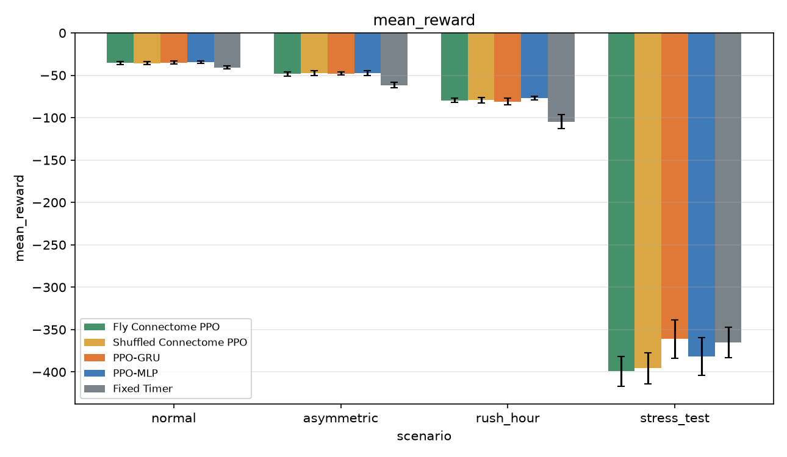

# Can a Fly Control Traffic?

Pengujian kelayakan sub-konektom otak lalat buah (*Drosophila melanogaster*, dataset `FlyWire FAFB v783`) sebagai inti rekuren pada kebijakan pengendalian lampu lalu lintas persimpangan empat arah berbasis *Proximal Policy Optimization* (PPO), berjalan 100% di CPU.

Proyek ini merumuskan **uji kapabilitas (*capability study*)** dengan pola **Biological Reservoir Computing**: matriks sinaptik asli dari **2.500 neuron** sirkuit **Central Complex (`PB`, `FB`, `EB`, `NO`)** dan **Mushroom Body (`MB_*`)** (`87.171` sisi berpolaritas eksitatori `ACH` dan inhibitori `GABA`/`GLUT`, *sparsity* `98,61%`) dibekukan (*frozen*, `requires_grad=False`), sementara PPO melatih tepat **`70.006` parameter adapter** (`input_projection`, `tau_logit`, `actor_head`, dan `critic_head`).


---

## Fitur Utama & Artefak Siap Pakai

Repositori ini menyertakan sub-konektom hasil ekstraksi (`artifacts/fly_subconnectome.pt`, `artifacts/fly_subconnectome_shuffled.pt`), **4 checkpoint model final (~5 juta langkah latih)** di `artifacts/checkpoints/{fly,fly_shuffled,gru,mlp}_ppo.pt`, serta laporan benchmark terverifikasi di `artifacts/benchmarks/`. Anda dapat langsung menjalankan Web Lab interaktif maupun evaluasi tanpa perlu mengunduh dataset mentah `dataset/` (`>333 MiB`).

- **Web Lab Interaktif (`http://127.0.0.1:8080`)**:
  - **Live Simulation (`/simulation`)**: Simulasi **3D View** Three.js (`Top View`, `3D Angle`, `Street`, `Cinematic`, `OrbitControls`, HUD sinyal per arah) dan sakelar **2D Map**, injeksi kendaraan manual per lajur, visualisasi **3D Brain** FlyWire (`2.500` neuron CX/MB + pulsa sinapsis), slider farmakologi $g_{\text{exc}}$ / $g_{\text{inh}}$ *real-time*, serta lesi sirkuit *in-silico*.
  - **Training Studio (`/training`)**: Pelatihan PPO 8 environment CPU paralel (`fly`, `fly_shuffled`, `gru`, `mlp`), fitur *resume checkpoint*, kustomisasi hyperparameter, dan **Live Policy Preview** via WebSocket.
  - **Benchmark & Connectome (`/benchmark`)**: Evaluasi deterministik multi-skenario langsung dari antarmuka web, ringkasan statistik graf `FAFB v783`, serta tabel uji farmakologi dan lesi.
  - **3D Architecture (`/architecture`) & Documentation (`/docs`)**: Eksplorasi 3D aliran *Forward Pass* vs *Backward Gradient* pada `FlyConnectomePolicy` dan laporan teknis interaktif.

---

## Instalasi & Cara Menjalankan

Memerlukan Python `>= 3.11` dan [`uv`](https://docs.astral.sh/uv/) (indeks PyTorch CPU sudah dikonfigurasi otomatis di `pyproject.toml`):

```bash
# 1. Buat virtual environment & instal dependensi inti (CPU-only PyTorch)
uv sync

# Opsional: sertakan paket ekstraksi CSV/3D, Pygame sandbox, & pytest
uv sync --extra all
```

### 1. Menjalankan Web Lab Utama (Direkomendasikan)

```bash
uv run python scripts/launch_web_lab.py --host 127.0.0.1 --port 8080
```

Buka `http://127.0.0.1:8080` di browser. Untuk menjalankan penampil 3D simpang secara terpisah tanpa panel penuh:

```bash
uv run python simulation3d/serve.py --host 127.0.0.1 --port 8888
```

### 2. Perintah CLI & Notebook (Training, Benchmark, Pengujian)

```bash
# Evaluasi komparatif 5 pengendali pada 4 skenario (10 seed, 500 langkah/episode)
uv run python scripts/run_benchmark.py

# Latih kebijakan PPO dari CLI (mendukung --resume dan --parallel-models 1|2|4)
uv run python scripts/train_agents.py --agents fly fly_shuffled mlp gru --total-timesteps 163840 --suffix "_custom"

# Jalankan seluruh unit & integration tests
uv run pytest tests/ -q

# Opsional: ekstrak ulang sub-connectome bila menyediakan dataset/connections_princeton.csv
# uv run --extra extract python scripts/extract_connectome.py
```

Eksplorasi pelatihan interaktif (lokal maupun Google Colab) tersedia di [`notebooks/train_agents.ipynb`](notebooks/train_agents.ipynb).

---

## Desain Pengendali & Kontrol Ilmiah

Untuk menguji apakah topologi biologis memberikan kontribusi nyata dibanding sekadar proyeksi rekuren berdimensi tinggi atau jaringan standar, kelima pengendali diuji pada anggaran parameter terlatih yang sebanding (~70 ribu parameter) di lingkungan yang identik (`max_steps = 500` / `1.000 s`, `min_green_steps = 6`, `yellow_steps = 2`, `all_red_steps = 1`, `collision_penalty = 80.0`):

| Pengendali | Kelas / Modul | Memori Rekuren | Parameter Terlatih | Peran Pembanding |
|---|---|---|---:|---|
| **Fly Connectome PPO** (`fly`) | `FlyConnectomePolicy` | `2.500` neuron *sparse* FAFB v783 (*frozen* $W_{\text{exc}}, W_{\text{inh}}$) | `70.006` | Model utama berbasis sub-konektom biologis asli (`1.800` CX + `700` MB, `2.880` sisi lintas wilayah). |
| **Shuffled Connectome PPO** (`fly_shuffled`) | `FlyConnectomePolicy` + `shuffled.py` | `2.500` neuron *sparse* teracak (*frozen*) | `70.006` | *Null model* (*global random edge rewiring*): mempertahankan jumlah sisi, distribusi bobot E/I, *sparsity* `98,61%`, dan *spectral radius* `0,95`, tetapi mengacak topologi modular (`35.430` sisi lintas wilayah). |
| **PPO-GRU** (`gru`) | `GRUBaselinePolicy` | `105` unit GRU terlatih penuh | `69.725` | Pembanding *end-to-end* rekuren artifisial standar. |
| **PPO-MLP** (`mlp`) | `MLPBaselinePolicy` | Tidak ada (2 lapis `Tanh`, lebar `250`) | `69.755` | Pembanding *feedforward* reaktif tanpa memori internal. |
| **Fixed Timer** (`fixed_timer`) | `FixedTimerAgent` | Tidak ada (aturan siklik `(10, 6, 10, 6)` langkah) | `0` | Baseline non-AI berjadwal waktu hijau tetap (`20s-12s-20s-12s`). |

### Invarian Statistik *Fly Connectome* vs *Shuffled Null Model*

| Properti Graf | Fly Connectome (`fly_subconnectome.pt`) | Shuffled Connectome (`fly_subconnectome_shuffled.pt`) | Keterangan |
|---|---|---|---|
| **Jumlah Neuron (`CX + MB`)** | `2.500` (`1.800` + `700`) | `2.500` (`1.800` + `700`) | Identik |
| **Sisi Eksitatori / Inhibitori** | `36.908` / `50.263` | `36.908` / `50.263` | Jumlah sisi & himpunan bobot identik, pasangan `(post, pre)` diacak |
| **Kejarangan (*Sparsity*)** | `98,6053%` | `98,6053%` | Identik (`87.171` sisi aktif dari `6.250.000` pasangan) |
| **Koneksi Lintas Wilayah (`CX <-> MB`)** | `2.880` sisi | `35.430` sisi | Modularitas biologis hancur pada *null model* |
| ***Raw* -> *Scaled Spectral Radius*** | `113,1494` -> `0,9500` | `0,1302` -> `0,9500` | Sama-sama dinormalisasi ke `0,95` sebelum dibekukan |

---

## Hasil Benchmark (~5 Juta Langkah Latih, 10 Seed per Skenario)

Tabel di bawah disinkronkan langsung dari [`artifacts/benchmarks/benchmark_table.md`](artifacts/benchmarks/benchmark_table.md) (`500` langkah / episode, `seed = 1000..1009`):

| Skenario | Agen | Parameter Terlatih | Mean Reward | Mean Queue | Mean Wait (s) | Mean Throughput | Mean Switches | Mean Collisions | Latency (ms/step) |
|---|---|---:|---:|---:|---:|---:|---:|---:|---:|
| `normal` | Fly Connectome PPO | 70.006 | -35.446 | 9.32 | 25.82 | 352.4 | 54.7 | 0.00 | 0.306 |
| `normal` | Shuffled Connectome PPO | 70.006 | -35.630 | 9.37 | 25.99 | 353.2 | 55.0 | 0.00 | 0.299 |
| `normal` | PPO-GRU | 69.725 | -34.923 | 9.32 | 26.07 | 348.0 | 53.5 | 0.00 | 0.115 |
| `normal` | PPO-MLP | 69.755 | -34.605 | 9.21 | 25.75 | 349.1 | 52.9 | 0.00 | 0.106 |
| `normal` | Fixed Timer (`10-6-10-6`) | 0 | -40.626 | 11.01 | 30.69 | 348.8 | 45.0 | 0.00 | 0.002 |
| `asymmetric` | Fly Connectome PPO | 70.006 | -48.370 | 13.75 | 23.57 | 571.5 | 55.0 | 0.00 | 0.336 |
| `asymmetric` | Shuffled Connectome PPO | 70.006 | -47.624 | 13.88 | 23.83 | 570.1 | 55.0 | 0.00 | 0.270 |
| `asymmetric` | PPO-GRU | 69.725 | -47.893 | 13.34 | 22.63 | 577.1 | 53.6 | 0.00 | 0.129 |
| `asymmetric` | PPO-MLP | 69.755 | -47.616 | 13.47 | 23.27 | 565.5 | 53.5 | 0.00 | 0.089 |
| `asymmetric` | Fixed Timer (`10-6-10-6`) | 0 | -61.537 | 19.12 | 32.92 | 569.5 | 45.0 | 0.00 | 0.002 |
| `rush_hour` | Fly Connectome PPO | 70.006 | -79.574 | 25.65 | 27.96 | 886.7 | 54.8 | 0.00 | 0.288 |
| `rush_hour` | Shuffled Connectome PPO | 70.006 | -79.431 | 25.60 | 28.05 | 879.7 | 54.3 | 0.00 | 0.275 |
| `rush_hour` | PPO-GRU | 69.725 | -80.937 | 26.01 | 28.09 | 894.5 | 53.9 | 0.00 | 0.107 |
| `rush_hour` | PPO-MLP | 69.755 | -76.871 | 24.71 | 27.18 | 879.3 | 54.0 | 0.00 | 0.090 |
| `rush_hour` | Fixed Timer (`10-6-10-6`) | 0 | -104.742 | 35.43 | 38.61 | 855.9 | 45.0 | 0.00 | 0.002 |
| `stress_test` | Fly Connectome PPO | 70.006 | -399.038 | 144.89 | 88.38 | 1448.8 | 54.9 | 5.00 | 0.293 |
| `stress_test` | Shuffled Connectome PPO | 70.006 | -395.579 | 140.52 | 84.97 | 1460.1 | 54.9 | 14.00 | 0.296 |
| `stress_test` | PPO-GRU | 69.725 | -361.209 | 129.12 | 78.82 | 1468.7 | 52.6 | 8.60 | 0.109 |
| `stress_test` | PPO-MLP | 69.755 | -381.887 | 131.83 | 78.69 | 1487.1 | 53.8 | 25.20 | 0.088 |
| `stress_test` | Fixed Timer (`10-6-10-6`) | 0 | -365.067 | 126.19 | 76.47 | 1482.8 | 45.0 | 20.90 | 0.002 |

### Ringkasan Temuan Faktual

1. **Rezim Non-Jenuh (`normal`, `asymmetric`, `rush_hour`)**: Seluruh keempat kebijakan RL mencatat `0.00` kolisi dan menurunkan waktu tunggu serta panjang antrean dibanding `Fixed Timer` (pada `rush_hour`, waktu tunggu rata-rata turun dari `38.61 s` menjadi `27.18–28.09 s`).
2. **Rezim Saturasi Ekstrem (`stress_test`)**: `PPO-GRU` meraih `Mean Reward` tertinggi (`-361.209`, melampaui `Fixed Timer` `-365.067` dengan `8.60` kolisi), sedangkan `Fly Connectome PPO` mencatat `Mean Collisions` paling rendah di antara seluruh pengendali (`5.00` kolisi vs `14.00` pada `Shuffled Connectome PPO`, `20.90` pada `Fixed Timer`, dan `25.20` pada `PPO-MLP`) namun dengan antrean rata-rata lebih tinggi (`144.89`).
3. **Perturbasi Farmakologi & Lesi Sirkuit (`rush_hour`)**: Perubahan pengali sinaptik (`g_exc = 1.8`, `g_inh = 0.2` atau `2.0`) serta lesi `25%` neuron CX, MB, maupun acak mempertahankan `0.00` kolisi dengan `Mean Reward` pada rentang `-80.407` hingga `-78.480`.
4. **Biaya Komputasi CPU**: Perkalian matriks *sparse* `2.500 × 2.500` pada `Fly` dan `Shuffled Connectome` membutuhkan `0.270–0.336 ms/step`, sekitar 2,5–3 kali lebih lambat dibanding `PPO-GRU` (`0.107–0.129 ms/step`) dan `PPO-MLP` (`0.088–0.106 ms/step`).




Figur evaluasi lengkap lainnya tersedia di `artifacts/benchmarks/`: [scenario_comparison.png](artifacts/benchmarks/scenario_comparison.png), [training_curves.png](artifacts/benchmarks/training_curves.png), [pharmacology_ablation.png](artifacts/benchmarks/pharmacology_ablation.png), dan [experiment_evolution_comparison.png](artifacts/benchmarks/experiment_evolution_comparison.png).

---

## Struktur Direktori

```text
.
├── artifacts/                      # Sub-connectome (.pt), 4 checkpoint PPO (~5M), & laporan benchmark
│   ├── fly_subconnectome.pt
│   ├── fly_subconnectome_shuffled.pt
│   ├── checkpoints/                # fly_ppo.pt, fly_shuffled_ppo.pt, gru_ppo.pt, mlp_ppo.pt
│   └── benchmarks/                 # JSON, tabel Markdown, & grafik hasil evaluasi
├── docs/                           # Dokumentasi berjenjang (lihat docs/README.md)
│   ├── README.md                   # Indeks navigasi dokumentasi 3 lapis
│   ├── MASTER_DOC.md               # Laporan teknis & analisis hasil menyeluruh
│   ├── TRAINING_AND_EPISODE_GUIDE.md
│   ├── VARIABLES_AND_MATH.md
│   ├── config.md
│   ├── src/                        # Referensi teknis per submodul backend
│   └── scripts/                    # Referensi CLI & notebook
├── frontend/                       # SPA Web Lab (HTML Partials, CSS, Canvas 2D, Three.js)
│   ├── assets/brain/               # Mesh anatomi 3D (.glb) & koordinat soma neuron
│   ├── partials/                   # Panel simulation, training, benchmark, architecture, docs
│   ├── js/                         # Controller UI & modul bersama 3D simpang (js/sim3d/)
│   └── vendor/three/               # Pustaka Three.js lokal tanpa ketergantungan CDN
├── notebooks/
│   └── train_agents.ipynb          # Notebook interaktif training & benchmark (lokal / Colab)
├── scripts/                        # Entrypoint CLI (extract, build_brain_assets, train, benchmark, web)
├── simulation3d/                   # Server penampil 3D simpang mandiri (port 8888)
├── src/fly_traffic/                # Paket Python utama
│   ├── config.py                   # 5 frozen dataclass konfigurasi terpusat
│   ├── connectome/                 # Ekstraksi CSV Polars, shuffled null model, & aset otak 3D
│   ├── environment/                # TrafficIntersectionEnv (Gymnasium), interlock, & profil Poisson
│   ├── agents/                     # ConnectomeRecurrentCell, Fly/MLP/GRU policies, FixedTimer
│   ├── training/                   # RecurrentRolloutBuffer & sequence-chunked PPOTrainer
│   ├── evaluation/                 # AgentEvaluator & BenchmarkPlotter
│   ├── web/                        # Server aiohttp/WebSocket, SimulationService, TrainingJobManager
│   └── ui/                         # Aplikasi desktop Pygame opsional
├── tests/                          # Unit & integration tests (pytest)
├── pyproject.toml
└── uv.lock
```

---

## Dokumentasi Lanjutan

Mulai dari [Indeks Dokumentasi (`docs/README.md`)](docs/README.md):
1. **[Laporan Teknis Utama (`docs/MASTER_DOC.md`)](docs/MASTER_DOC.md)** — Metodologi ekstraksi konektom, spesifikasi lingkungan dan mekanisme kolisi, arsitektur kebijakan, eksperimen evolusi skema latih, hasil evaluasi, serta batasan studi.
2. **[Panduan Siklus Episode & Loop PPO (`docs/TRAINING_AND_EPISODE_GUIDE.md`)](docs/TRAINING_AND_EPISODE_GUIDE.md)** — Alur data sistem, anatomi 1 episode `500` langkah, *decision masking*, dan *Live Policy Preview*.
3. **[Referensi Kode & Matematika](docs/VARIABLES_AND_MATH.md)** — Kamus simbol persamaan, [Referensi Konfigurasi](docs/config.md), [Referensi Submodul Backend](docs/src/README.md), dan [Referensi Skrip CLI](docs/scripts/cli.md).

---

## Sumber Dataset & Referensi

Berkas mentah (`dataset/`, `>333 MiB`) dikecualikan dari Git karena sudah dikemas menjadi matriks sparse siap pakai di `artifacts/fly_subconnectome*.pt` dan aset 3D di `frontend/assets/brain/`. Sumber data asli dapat diakses melalui:

1. **FlyWire FAFB v783 Whole-Brain Connectome (`connections_princeton.csv`):** [codex.flywire.ai](https://codex.flywire.ai) — Dorkenwald, S., Matsliah, A., Yu, S.-C., et al. (2024). *Neuronal wiring diagram of an adult brain.* Nature, 634, 124–138. [doi:10.1038/s41586-024-07558-y](https://doi.org/10.1038/s41586-024-07558-y)
2. **Prediksi Neurotransmiter Sinaptik (`ACH`, `GABA`, `GLUT`):** Eckstein, N., Bates, A. S., Champion, A., et al. (2024). *Neurotransmitter classification from electron microscopy images at synaptic sites in Drosophila melanogaster.* Cell, 187(10), 2574–2594. [doi:10.1016/j.cell.2024.03.016](https://doi.org/10.1016/j.cell.2024.03.016)
3. **Anotasi Neuron & Koordinat Soma (`neuron_annotations.tsv`):** [flyconnectome/flywire_annotations](https://github.com/flyconnectome/flywire_annotations) — Schlegel, P., Yin, Y., Bates, A. S., et al. (2024). *Whole-brain annotation and multi-connectome cell typing of Drosophila.* Nature, 634, 139–152. [doi:10.1038/s41586-024-07686-5](https://doi.org/10.1038/s41586-024-07686-5)
4. **Mesh Neuropil & Permukaan Otak 3D:** [JFRC2NP.surf.fw.zip](https://github.com/navis-org/fafbseg-py/raw/master/fafbseg/data/JFRC2NP.surf.fw.zip) (Ito et al., 2014, [doi:10.1016/j.neuron.2013.12.017](https://doi.org/10.1016/j.neuron.2013.12.017)), [brain_mesh_v3 (`1:0:0`)](https://storage.googleapis.com/flywire_neuropil_meshes/whole_neuropil/brain_mesh_v3/mesh/1:0:0), dan FAFB v14 EM Volume (Zheng et al., 2018, [doi:10.1016/j.cell.2018.06.019](https://doi.org/10.1016/j.cell.2018.06.019)).
