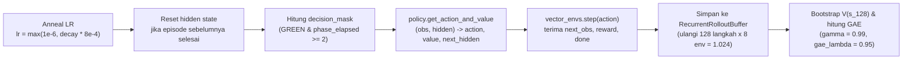
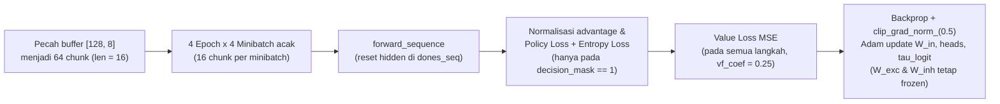

# Dapatkah Lalat Mengatur Lalu Lintas?

Laporan teknis tentang pengujian kelayakan sub-konektom *Drosophila melanogaster* sebagai inti rekuren (*recurrent core*) pada kebijakan pengendalian lampu lalu lintas persimpangan empat arah.

---

## Pendahuluan: Pertanyaan Penelitian

Proyek ini berangkat dari pertanyaan mendasar:

> *"Apakah sub-graf saraf biologis otak lalat buah, yang diekstrak dari data konektom nyata, dapat berfungsi sebagai inti rekuren dalam kebijakan pengendalian lampu lalu lintas pada persimpangan empat arah?"*

Pertanyaan ini sengaja dirumuskan sebagai uji kemampuan (*capability question*), bukan klaim keunggulan atas pengendali konvensional. Fokus utamanya adalah memeriksa apakah topologi sinaptik biologis—beserta pemisahan polaritas eksitatori-inhibitori dan dinamika memori rekuren—dapat mendukung pembelajaran penguat (*reinforcement learning*), sekaligus memungkinkan manipulasi farmakologis dan lesi sirkuit secara langsung selama simulasi berjalan.

---

## Bagian I: Konstruksi Sub-Konektom Lalat

Sebelum dipakai sebagai inti kebijakan, graf saraf harus diekstrak dari data mentah, dipisahkan berdasarkan polaritas neurotransmiter, dan diskalakan agar dinamika rekurennya tetap stabil.

### Sumber Data

Data konektom berasal dari dataset **FlyWire FAFB v783** melalui berkas `dataset/connections_princeton.csv` (`261 MiB` tidak terkompresi; `66 MiB` dalam arsip `.csv.gz`). Tabel ini mencatat setiap pasangan neuron pengirim (`pre_root_id`) dan penerima (`post_root_id`), jumlah sinaps (`syn_count`), tipe neurotransmiter (`nt_type`), serta neuropil lokasi sinaps (`neuropil`).

### Seleksi Neuron dan Sirkuit Target

Sub-graf dipilih dari dua wilayah anatomis utama pada konfigurasi `ConnectomeConfig` (`src/fly_traffic/config.py`):

1. **Central Complex (CX)** — mencakup neuropil `PB`, `FB`, `EB`, dan `NO`, yang berperan dalam seleksi aksi dan navigasi arah. Kuota targetnya adalah 1.800 neuron.
2. **Mushroom Body (MB)** — mencakup delapan neuropil kiri dan kanan (`MB_CA_L/R`, `MB_ML_L/R`, `MB_PED_L/R`, dan `MB_VL_L/R`), yang berperan dalam memori asosiatif dan konteks. Kuota targetnya adalah 700 neuron.

Pada masing-masing wilayah, neuron diurutkan berdasarkan total sinaps insiden (`syn_count` masuk ditambah keluar) lalu diambil sebanyak kuota. Neuron yang sudah masuk ke himpunan CX dikecualikan dari seleksi MB agar tidak terjadi duplikasi. Setelah 2.500 neuron terpilih, sisi-sisi sinaptik diinduksi di seluruh neuropil sehingga koneksi lintas wilayah (*cross-region edges*) antara CX dan MB tetap terjaga.

Hasil ekstraksi yang tersimpan di `artifacts/fly_subconnectome.pt` memuat:

- **Total neuron**: 2.500 (1.800 CX + 700 MB)
- **Sisi eksitatori**: 36.908
- **Sisi inhibitori**: 50.263
- **Koneksi lintas wilayah (CX ↔ MB)**: 2.880 baris sinaptik
- **Tingkat kejarangan (*sparsity*)**: `98,6053%` (artinya `98,6053%` dari `6.250.000` pasangan potensial bernilai nol, dan hanya `1,3947%` yang memiliki koneksi non-nol)

Format penyimpanan *Compressed Sparse Row* (CSR) memanfaatkan tingkat kejarangan ini agar perkalian matriks hanya memproses sisi yang aktif.

### Pemisahan Polaritas dan Pembobotan Sinaptik

Berdasarkan kolom `nt_type`, koneksi dipisahkan ke dalam dua matriks ketetanggaan terpisah:

- $W_{\text{exc}}$ — sinaps eksitatori (`ACH` / asetilkolin) yang memperkuat aktivasi neuron penerima.
- $W_{\text{inh}}$ — sinaps inhibitori (`GABA` dan `GLUT`) yang menekan aktivasi neuron penerima.

Bobot setiap pasangan terarah `(post, pre)` dihitung dengan kompresi logaritmik:

$$w_{ij} = \log(1 + \text{syn\_count}_{ij})$$

Pendekatan *log1p* mencegah pasangan dengan ribuan sinaps mendominasi jaringan secara ekstrem, sementara koneksi berjumlah sinaps kecil tetap berkontribusi secara proporsional.

### Normalisasi *Spectral Radius*

Matriks gabungan mentah $W_{\text{exc}} - W_{\text{inh}}$ memiliki *spectral radius* (magnitudo nilai eigen terbesar) sebesar `113,1494`. Nilai di atas `1,0` berisiko membuat aktivasi rekuren meledak (*explode*) seiring bertambahnya langkah waktu. Oleh karena itu, kedua matriks dikalikan faktor penskalaan yang sama hingga *spectral radius* bersihnya turun menjadi `0,9500`.

```python
# File: src/fly_traffic/connectome/preprocessor.py
# Potongan dari ConnectomePreprocessor.extract() (baris 98-110)

raw_net_matrix = (raw_excitatory_matrix - raw_inhibitory_matrix).astype(np.float64)
raw_spectral_radius = self._compute_spectral_radius(raw_net_matrix)
scaling_factor = (
    self.config.target_spectral_radius / raw_spectral_radius
    if raw_spectral_radius > 0.0
    else 1.0
)

scaled_excitatory_matrix = (raw_excitatory_matrix * scaling_factor).astype(np.float32)
scaled_inhibitory_matrix = (raw_inhibitory_matrix * scaling_factor).astype(np.float32)
```

Setelah penskalaan, matriks dikonversi ke tensor koordinat (COO) dan diserialisasi ke `artifacts/fly_subconnectome.pt` bersama daftar `neuron_ids`, label `circuit_groups`, `dominant_neuropils`, `dominant_nts`, dan metadata ekstraksi. Dengan begitu, proses training tidak perlu memindai ulang berkas CSV mentah setiap kali dijalankan.

### Model Nol Terkontrol (*Shuffled Connectome Null Model*)

Untuk mengisolasi kontribusi **topologi biologis otak lalat** dari sekadar efek proyeksi ke ruang rekuren berdimensi tinggi (*reservoir computing*), modul `src/fly_traffic/connectome/shuffled.py` menyediakan pembanding terkontrol `artifacts/fly_subconnectome_shuffled.pt` (*global uniform random edge rewiring*, `seed = 42`):

- **Ukuran dan kepadatan identik**: tetap `2.500` neuron (`CX=1800`, `MB=700`) dengan *sparsity* persis `98,6053%`.
- **Distribusi bobot dan polaritas identik**: seluruh nilai bobot dari `36.908` sisi eksitatori dan `50.263` sisi inhibitori dipertahankan, lalu dipasangkan ulang secara acak seragam tanpa duplikasi ke pasangan `(post, pre)` di seluruh matriks `2.500 × 2.500`. Langkah ini menghancurkan modularitas biologis (koneksi lintas wilayah `CX ↔ MB` meningkat dari `2.880` menjadi `35.430`).
- **Stabilitas spektral dan anggaran latih identik**: matriks hasil pengacakan memiliki *spectral radius* mentah `0,1302` lalu diskalakan kembali ke `0,9500`, dibekukan (*frozen*), dan dilatih dengan PPO pada `70.006` parameter adapter yang sama persis (`model_type = "fly_shuffled"`).

Dengan kontrol ini, hasil perbandingan terhadap `Fly Connectome PPO` memiliki interpretasi objektif apa pun keluarannya: keunggulan `Fly Connectome` mengindikasikan peran motif sirkuit biologis; performa setara menunjukkan dominasi keseimbangan E/I, *sparsity*, dan ekspansi dimensi `2.500`; sedangkan keunggulan `Shuffled` mengindikasikan bahwa spesialisasi struktural biologis justru membatasi pencampuran sinyal pada domain persimpangan.

---

## Bagian II: Lingkungan Simulasi Persimpangan

Lingkungan simulasi (`TrafficIntersectionEnv` di `src/fly_traffic/environment/traffic_env.py`) mengimplementasikan antarmuka Gymnasium berbasis NumPy yang berjalan sepenuhnya di CPU.

### Geometri Persimpangan dan Pengontrol Sinyal

Persimpangan memiliki 4 pendekatan (Utara, Selatan, Timur, Barat), masing-masing terdiri atas lajur lurus dan lajur belok kiri, sehingga total ada 8 lajur (`NUM_LANES = 8`). Tiap lajur dikelola sebagai antrean FIFO (`LaneQueue`) yang mencatat langkah kedatangan setiap kendaraan untuk menghitung waktu tunggu secara akurat.

Terdapat 4 fasa sinyal non-konflik (`SignalPhase`):

| Indeks Fasa | Lajur Hijau | Label |
|---|---|---|
| `0` | Utara Lurus, Selatan Lurus | `NS Straight` |
| `1` | Utara Belok, Selatan Belok | `NS Turn` |
| `2` | Timur Lurus, Barat Lurus | `EW Straight` |
| `3` | Timur Belok, Barat Belok | `EW Turn` |

Setiap pergantian fasa dikawal oleh mesin status `SignalController` agar lampu hijau tidak pernah langsung berpindah ke fasa yang berkonflik sebelum durasi aman terpenuhi:

```python
# File: src/fly_traffic/environment/intersection_state.py
# Metode: SignalController.request_phase() (baris 150-168)

def request_phase(self, target_phase: SignalPhase) -> bool:
    if self.is_transitioning:
        return False
    if target_phase == self.active_phase:
        return False
    if self.phase_elapsed < self.min_green_steps:
        return False

    self.pending_phase = target_phase
    if self.yellow_steps > 0:
        self.stage = SignalStage.YELLOW
        self.stage_elapsed = 0
    elif self.all_red_steps > 0:
        self.stage = SignalStage.ALL_RED
        self.stage_elapsed = 0
    else:
        self._activate_pending_phase()
    return True
```

Secara bawaan, `min_green_steps = 2`, `yellow_steps = 1`, dan `all_red_steps = 1` dengan durasi satu langkah `dt_seconds = 2,0` detik.

### Ruang Observasi dan Ruang Aksi

Pada setiap langkah, agen menerima vektor observasi `22`-dimensi ($x_t$) dan memilih satu aksi diskrit dari `Discrete(4)` (fasa sinyal target):

- `obs[0:8]` — panjang antrean tiap lajur, dinormalisasi dengan `30,0` dan dibatasi ke `[0,0, 2,0]`.
- `obs[8:16]` — waktu tunggu kepala antrean tiap lajur (detik), dinormalisasi dengan `120,0` dan dibatasi ke `[0,0, 2,0]`.
- `obs[16:20]` — vektor *one-hot* fasa sinyal yang sedang aktif.
- `obs[20]` — penanda tahap transisi (`1,0` saat `YELLOW` atau `ALL_RED`, `0,0` saat `GREEN`).
- `obs[21]` — durasi fasa hijau berjalan, dinormalisasi dengan `20,0` dan dibatasi ke `[0,0, 2,0]`.

### Fungsi *Reward*

Setiap langkah simulasi menghasilkan skalar *reward* melalui metode `_compute_reward` (`traffic_env.py`, baris 569–582):

$$r_t = \text{reward\_scale} \cdot \Big(-\sum_{i=0}^{7} q_i - \alpha \cdot w_{\max} - \beta \cdot \mathbb{I}(\text{switch}) - c \cdot n_{\text{col}}\Big)$$

dengan komponen bawaan:

- $\sum q_i$: jumlah total kendaraan mengantre di 8 lajur.
- $\alpha = 0,1$ (`wait_penalty_alpha`): penalti terhadap waktu tunggu maksimum $w_{\max}$ (detik).
- $\beta = 1,0$ (`switch_penalty_beta`): penalti setiap kali fasa sinyal berpindah agar agen tidak berganti lampu terlalu sering.
- $c = 15,0$ (`collision_penalty`): penalti per kejadian tabrakan $n_{\text{col}}$.
- $\text{reward\_scale} = 0,005$: faktor skala agar nilai *reward* tetap stabil selama optimasi PPO (satu kolisi menurunkan *reward* langkah sebesar `15,0 × 0,005 = 0,075`).

### Model Kolisi dan *Safety Buffer*

Ketika `enable_collisions = True`, `TrafficIntersectionEnv._evaluate_collisions` (baris 430–567) memodelkan dua jenis pelanggaran/konflik di persimpangan:

1. **Konflik Lampu Merah (`red_light_conflict`)** — terjadi ketika suatu lajur merah menunggu lebih lama dari `red_light_wait_threshold_s = 120,0` detik (*queue starvation*) sementara ada lajur hijau yang berkonflik sedang melepas kendaraan. Probabilitas pelanggaran meningkat linear hingga batas `red_light_max_prob = 0,14`:

   $$p_{\text{red}} = \min\left(0,14,\ \frac{\text{head\_wait\_s} - 120,0}{140,0} \cdot 0,14\right)$$

2. **Konflik Pengosongan Kotak Persimpangan (`box_clearance_conflict`)** — saat fasa berpindah (`phase_switched = True`), lajur yang baru saja melepas berpeluang `dilemma_zone_prob = 0,18` menyisakan kendaraan tertinggal (*straggler*) di tengah persimpangan dengan sisa umur `2` langkah.

```python
# File: src/fly_traffic/environment/traffic_env.py
# Potongan dari _evaluate_box_clearance_conflicts (baris 454-504)

if phase_switched:
    for lane_index, departed in enumerate(previous_departures):
        if departed > 0 and float(self.np_random.random()) < self.config.dilemma_zone_prob:
            self._box_stragglers.append([lane_index, 2])

for straggler_lane, remaining_steps in self._box_stragglers:
    if remaining_steps <= 0:
        continue
    conflicting_set = CONFLICTING_LANES[straggler_lane]
    conflicting_victims = [
        lane_index for lane_index in discharging_lanes
        if lane_index in conflicting_set
    ]
    if conflicting_victims:
        # Catat box_clearance_conflict dengan korban acak dari lajur berkonflik
        ...
```

Dengan pengaturan standar (`yellow_steps = 1` dan `all_red_steps = 1`), jeda dua langkah tanpa pelepasan kendaraan menghabiskan umur *straggler* (`2 → 1 → 0`) sebelum fasa baru mendapat lampu hijau. Jika `all_red_steps` diubah menjadi `0` (mode *Yellow Only* lewat `set_safety_buffer(0)`), fasa baru menyala hijau saat `remaining_steps = 1`, sehingga risiko `box_clearance_conflict` melonjak tajam.

---

## Bagian III: Arsitektur Pengendali (Agents)

Lima pengendali tersedia pada lingkungan dan metrik yang identik. Keempat model pembelajaran mesin disetel agar memiliki jumlah parameter terlatih yang setara (sekitar 70 ribu parameter):

| Pengendali | Kelas / Modul | Memori Rekuren | Parameter Terlatih |
|---|---|---|---|
| **Fly Connectome PPO** (`fly`) | `FlyConnectomePolicy` (`fly_policy.py`) | Ya (`2.500` neuron *sparse* FAFB v783 asli) | `70.006` |
| **Shuffled Connectome PPO** (`fly_shuffled`) | `FlyConnectomePolicy` + `shuffled.py` | Ya (`2.500` neuron *sparse* teracak, *null model*) | `70.006` |
| **PPO-GRU** (`gru`) | `GRUBaselinePolicy` (`baselines.py`) | Ya (`105` unit GRU) | `69.725` |
| **PPO-MLP** (`mlp`) | `MLPBaselinePolicy` (`baselines.py`) | Tidak (2 lapis *feedforward*, lebar `250`) | `69.755` |
| **Fixed Timer** (`fixed_timer`) | `FixedTimerAgent` (`fixed_timer.py`) | Tidak (siklus tetap `(8, 4, 8, 4)` langkah) | `0` |

### Fly Connectome Policy

Inti kebijakan biologis adalah sel *leaky integrator* rekuren `ConnectomeRecurrentCell` yang memperbarui vektor aktivasi $h_t \in \mathbb{R}^{2500}$ di setiap langkah:

$$h_{t+1} = (1 - \tau) h_t + \tau \tanh\Big((g_{\text{exc}} W_{\text{exc}} - g_{\text{inh}} W_{\text{inh}}) h_t + W_{\text{in}} x_t + b_{\text{in}}\Big)$$

Keterangan komponennya:

- $W_{\text{exc}}$ dan $W_{\text{inh}}$ **dibekukan (*frozen*)** selama training (`requires_grad = False`, didaftarkan melalui `register_buffer`) agar struktur topologi konektom FAFB v783 tetap utuh. Pada saat *backward pass* (BPTT), *autograd* PyTorch tidak menghitung turunan untuk bobot sinapsis biologis, melainkan hanya meneruskan gradien melalui matriks transpose $W_{\text{exc}}^T$ dan $W_{\text{inh}}^T$ agar pembaruan dapat mencapai `input_projection` dan `tau_logit`.
- **Parameter yang dilatih** (`70.006` total) hanya proyeksi masukan `input_projection` (`55.000` bobot $W_{\text{in}}$ + `2.500` bias = `57.500`), `actor_head` (`2.500 × 4 + 4 = 10.004`), `critic_head` (`2.500 × 1 + 1 = 2.501`) untuk mengestimasi nilai keadaan (*state value*) $V(s_t)$, serta `tau_logit` (`1` parameter) yang memetakan *leak rate* $\tau$ ke rentang `(0,05, 0,95)`.
- **Kontrol *in-silico* langsung**: pengali gain $g_{\text{exc}}$ (ACh) dan $g_{\text{inh}}$ (GABA/Glu) dapat digeser secara *real-time* pada rentang `[0,0, 2,5]`, sementara buffer biner `lesion_mask` dapat menonaktifkan (*lesion*) sebagian neuron CX, MB, atau acak tanpa membangun ulang matriks sparse.

```python
# File: src/fly_traffic/agents/connectome_cell.py
# Metode: ConnectomeRecurrentCell.forward() (baris 107-127)

def forward(self, obs: torch.Tensor, hidden_state: torch.Tensor) -> torch.Tensor:
    mask = self.lesion_mask
    masked_hidden = hidden_state * mask

    hidden_t = masked_hidden.transpose(0, 1)
    exc_drive = torch.sparse.mm(self.w_exc_csr, hidden_t).transpose(0, 1)
    inh_drive = torch.sparse.mm(self.w_inh_csr, hidden_t).transpose(0, 1)

    synaptic_input = (
        self.g_exc * exc_drive
        - self.g_inh * inh_drive
        + self.input_projection(obs)
    )
    tau = self.leak_rate
    next_hidden = (1.0 - tau) * masked_hidden + tau * torch.tanh(synaptic_input)
    return next_hidden * mask
```

Pada `FlyConnectomePolicy.forward_step()` (`src/fly_traffic/agents/fly_policy.py`, baris 59–68), `next_hidden` diteruskan ke `actor_head` untuk menghasilkan *logits* 4 fasa dan ke `critic_head` untuk menghasilkan skalar $V(s_t)$.

---

## Bagian IV: Pelatihan PPO di CPU

Ketiga agen neural dilatih di CPU menggunakan *Proximal Policy Optimization* (`PPOTrainer` pada `src/fly_traffic/training/ppo_trainer.py`).

### Konfigurasi Rollout dan Masking Keputusan

- **Lingkungan Paralel**: 8 instans `TrafficIntersectionEnv` dijalankan bersamaan via `SyncVectorEnv` dengan profil `mixed`. Tiap reset episode memilih secara acak salah satu dari `normal`, `asymmetric`, `asymmetric_ew`, atau `rush_hour`, disertai pengacakan laju kedatangan `Uniform(0,85, 1,15)`.
- **Jadwal Training**: `rollout_steps = 128` menghasilkan `8 × 128 = 1.024` transisi per update. Untuk pelatihan standar `163.840` langkah, proses berjalan selama `160` update dengan *learning rate* menurun linear dari `8e-4` menjadi `1,2e-4` (`anneal_lr = True`).
- **Decision Mask**: saat sinyal berada pada tahap `YELLOW`, `ALL_RED`, atau lampu `GREEN` yang belum mencapai `min_green_steps = 2`, agen secara fisik tidak dapat mengganti fasa. `_compute_decision_mask()` menandai langkah-langkah terkunci tersebut bernilai `0` agar gradien aktor dan entropi hanya dihitung pada langkah pengambilan keputusan yang sah.

### Alur Rollout dan Pembaruan Bobot PPO

**1. Fase Pengumpulan Rollout (per Update `1..160`)**



**2. Fase Optimasi Sekuens (`_ppo_update`)**



Di bawah ini adalah bagian inti dari `_ppo_update()` yang menghitung ketiga komponen kerugian dan memperbarui parameter terlatih:

```python
# File: src/fly_traffic/training/ppo_trainer.py
# Potongan dari PPOTrainer._ppo_update() (baris 361-425)

action_logits, predicted_values, _ = policy.forward_sequence(
    obs_seq=minibatch.obs_seq,
    initial_hidden=minibatch.initial_hidden,
    dones_seq=minibatch.episode_starts_seq,
)
action_distribution = Categorical(logits=action_logits)
new_log_probs = action_distribution.log_prob(minibatch.actions_seq)
step_entropy = action_distribution.entropy()

probability_ratio = torch.exp(new_log_probs - minibatch.old_log_probs_seq)
decision_mask = minibatch.decision_masks_seq
valid_decision_count = decision_mask.sum().clamp(min=1.0)

advantages = minibatch.advantages_seq
advantage_mean = (advantages * decision_mask).sum() / valid_decision_count
advantage_variance = (
    ((advantages - advantage_mean) ** 2 * decision_mask).sum()
    / valid_decision_count
)
normalized_advantages = (advantages - advantage_mean) / (advantage_variance.sqrt() + 1e-8)

unclipped_surrogate = -normalized_advantages * probability_ratio
clipped_surrogate = -normalized_advantages * torch.clamp(
    probability_ratio, 1.0 - ppo_config.clip_coef, 1.0 + ppo_config.clip_coef
)
policy_loss = (
    torch.max(unclipped_surrogate, clipped_surrogate) * decision_mask
).sum() / valid_decision_count

value_loss = 0.5 * ((predicted_values - minibatch.returns_seq) ** 2).mean()
mean_entropy = (step_entropy * decision_mask).sum() / valid_decision_count
total_loss = policy_loss - ppo_config.ent_coef * mean_entropy + ppo_config.vf_coef * value_loss

optimizer.zero_grad()
total_loss.backward()
nn.utils.clip_grad_norm_(
    (p for p in policy.parameters() if p.requires_grad),
    ppo_config.max_grad_norm,
)
optimizer.step()
```

---

## Bagian V: Antarmuka Web Lab & Visualisasi 3D Otak Lalat

Seluruh siklus inferensi, manipulasi farmakologis, pelatihan CPU, dan evaluasi dapat dijalankan lewat server web lokal (`TrafficLabServer` di `src/fly_traffic/web/server.py`) yang berkomunikasi dengan browser melalui REST API dan dua kanal WebSocket (`/ws/simulation` dan `/ws/training`):

- **Simulasi Persimpangan 2D (`IntersectionRenderer`)**: menggambar antrean kendaraan per lajur secara 1-ke-1 dengan status lingkungan, lampu sinyal 3-lensa, zoom interaktif, serta injeksi kendaraan manual per lajur.
- **Visualisasi 3D Otak *Drosophila* (`BrainAssetBuilder` & `Brain3DRenderer`)**: dibangun dari mesh permukaan seluruh otak FlyWire (`brain_mesh_v3`), 78 mesh neuropil JFRC2 dalam ruang FAFB14.1, dan koordinat soma serta tipe sel v783 (2.499 dari 2.500 neuron cocok dengan `root_id`). Di browser, Three.js menampilkan:
  - Lokasi 2.500 neuron dalam dua mode tata letak (**Neuropil** maupun **Soma**) dengan pewarnaan aktivasi *live* $h_t$ (`-0,40` biru inhibitori hingga `+0,40` oranye eksitatori) dan penanda cincin merah untuk neuron yang dilesikan.
  - 3.000 sinapsis terkuat dengan pulsa arah aliran sinyal dari neuron presinaptik ke postsinaptik.
  - Inspektor neuron individual saat diklik (`root_id`, `cell_type`, neuropil dominan, neurotransmiter, dan nilai $h_t$), serta fallback matriks 2D `50 × 50`.
- **Training Studio**: menjalankan `TrainingJobManager` di thread terpisah dengan dukungan arsitektur `fly`, `fly_shuffled`, `mlp`, dan `gru`, kustomisasi hyperparameter PPO, penyimpanan berkas *checkpoint* kustom (`.pt`), serta pratinjau deterministik 4 langkah (*Live Policy Preview*) pada skenario `rush_hour` setiap selesai satu update PPO.
- **Benchmark & Connectome (`BenchmarkInspectorView` & `BenchmarkPlotter`)**: menyediakan pemilih model interaktif untuk membandingkan kombinasi model bawaan, `Shuffled Connectome PPO`, maupun *checkpoint* kustom `.pt` melalui `POST /api/benchmark/run` (`agent_keys`), lengkap dengan grafik batang komparatif `mean_reward`, `mean_wait_time_s`, dan `mean_collisions` baik di antarmuka web maupun berkas gambar Matplotlib (`training_curves.png`, `scenario_comparison.png`, dan `pharmacology_ablation.png`).
- **Eksplorasi Arsitektur 3D (`ArchitectureView`)**: halaman khusus yang memodelkan topologi *end-to-end* `FlyConnectomePolicy` dalam ruang 3D (`x_t`, `input_projection`, `ConnectomeRecurrentCell` dengan 2.500 neuron FAFB + $\tau$ + kontrol runtime, `actor_head`, `critic_head`, dan umpan balik lingkungan). Dilengkapi sakelar aliran **Forward Pass** vs **Backward Gradient**, filter status (*Trainable*, *Frozen Bio*, *Runtime*), peta komponen horizontal, inspektor per modul, serta panduan matematis 4 tahap.

---

## Bagian VI: Evaluasi dan Hasil

Evaluasi dilakukan secara deterministik menggunakan `AgentEvaluator` (`src/fly_traffic/evaluation/evaluator.py`) pada empat skenario dengan **10 seed identik** (`1000` sampai `1009`), masing-masing berdurasi `300` langkah (`600` detik simulasi):

1. **`normal`** — kedatangan kendaraan seimbang ringan–sedang di keempat arah.
2. **`asymmetric`** — koridor Utara–Selatan padat berkelanjutan, Timur–Barat ringan.
3. **`rush_hour`** — tiga fase berurutan: moderat (langkah `0–99`), lonjakan Utara–Selatan (`100–199`), dan lonjakan Timur–Barat (`200–299`).
4. **`stress_test`** — kondisi beban ekstrem di mana seluruh lajur mengalami laju kedatangan tinggi simultan (`high_arrival_rate = 0,90` kend/langkah di seluruh lajur NS dan EW) untuk menguji perilaku antrean panjang, saturasi kapasitas, dan batas resistensi pelanggaran lampu merah (`red_light_wait_threshold_s = 120,0` detik).

### Perbandingan Multi-Skenario (10 Seed, Checkpoint 163.840 Steps)

Angka di bawah disinkronkan langsung dari `artifacts/benchmarks/benchmark_table.md` dan `artifacts/benchmarks/benchmark_summary.json`:

| Skenario | Agen | Mean Reward | Mean Queue | Mean Wait (s) | Mean Throughput | Mean Switches | Mean Collisions | Latency (ms/step) |
|---|---|---:|---:|---:|---:|---:|---:|---:|
| `normal` | Fixed Timer | -17.688 | 8.06 | 22.33 | 208.2 | 37.0 | 0.00 | 0.002 |
| `normal` | PPO-MLP | -10.731 | 5.03 | 13.90 | 211.9 | 71.0 | 0.00 | 0.075 |
| `normal` | PPO-GRU | -12.010 | 5.62 | 15.50 | 212.7 | 74.0 | 0.00 | 0.165 |
| `normal` | Fly Connectome PPO | -11.477 | 5.29 | 14.50 | 213.6 | 68.0 | 0.00 | 0.189 |
| `asymmetric` | Fixed Timer | -31.220 | 15.93 | 28.14 | 328.0 | 37.0 | 0.00 | 0.001 |
| `asymmetric` | PPO-MLP | -16.544 | 8.27 | 14.30 | 337.3 | 72.2 | 0.00 | 0.068 |
| `asymmetric` | PPO-GRU | -19.962 | 9.21 | 15.88 | 338.5 | 69.0 | 0.00 | 0.077 |
| `asymmetric` | Fly Connectome PPO | -16.792 | 8.55 | 15.09 | 332.5 | 62.8 | 0.00 | 0.198 |
| `rush_hour` | Fixed Timer | -29.838 | 15.26 | 26.29 | 324.7 | 37.0 | 0.00 | 0.001 |
| `rush_hour` | PPO-MLP | -18.950 | 9.55 | 16.65 | 329.8 | 71.5 | 0.00 | 0.065 |
| `rush_hour` | PPO-GRU | -22.309 | 10.85 | 18.35 | 339.5 | 70.3 | 0.00 | 0.106 |
| `rush_hour` | Fly Connectome PPO | -18.269 | 9.16 | 16.02 | 332.3 | 67.1 | 0.00 | 0.473 |
| `stress_test` | Fixed Timer | -241.743 | 140.88 | 85.60 | 770.6 | 37.0 | 42.50 | 0.005 |
| `stress_test` | PPO-MLP | -317.427 | 185.54 | 136.41 | 546.7 | 73.2 | 41.90 | 0.182 |
| `stress_test` | PPO-GRU | -272.365 | 150.45 | 116.43 | 544.7 | 59.6 | 55.60 | 0.299 |
| `stress_test` | Fly Connectome PPO | -320.557 | 191.08 | 143.97 | 521.5 | 71.3 | 42.80 | 0.486 |

Pada skenario `normal`, `asymmetric`, dan `rush_hour` dengan ambang batas kesabaran lampu merah `120,0` detik, seluruh agen menghasilkan rata-rata `0,00` kolisi karena waktu tunggu antrean tidak pernah menembus batas 120 detik pada beban standar. Pada profil beban ekstrem `stress_test`, antrean terakumulasi melampaui 120 detik sehingga memicu pelanggaran `red_light_conflict` di seluruh model, dengan Fixed Timer menghasilkan 42,50 kolisi, PPO-MLP 41,90, Fly Connectome PPO 42,80, dan PPO-GRU 55,60.

### Uji Farmakologi dan Lesi Sirkuit (`rush_hour`, 10 Seed)

Pengukuran ketahanan `Fly Connectome PPO` ketika gain sinaptik atau sebagian neuron dimodifikasi:

| Kondisi | `g_exc` | `g_inh` | Neuron Aktif | Mean Reward | Mean Wait (s) | Mean Throughput | Mean Switches | Mean Collisions |
|---|---:|---:|---:|---:|---:|---:|---:|---:|
| Baseline (`g_exc=1.0, g_inh=1.0`) | 1.00 | 1.00 | 2500 | -18.269 | 16.02 | 332.3 | 67.1 | 0.00 |
| High Excitation (`g_exc=1.8`) | 1.80 | 1.00 | 2500 | -18.635 | 15.99 | 338.6 | 65.0 | 0.00 |
| Low Inhibition (`g_inh=0.2`) | 1.00 | 0.20 | 2500 | -18.763 | 16.43 | 331.1 | 67.4 | 0.00 |
| High Inhibition (`g_inh=2.0`) | 1.00 | 2.00 | 2500 | -18.365 | 16.29 | 331.8 | 67.3 | 0.00 |
| CX Lesion 25% | 1.00 | 1.00 | 2050 | -19.169 | 16.50 | 340.7 | 67.6 | 0.00 |
| MB Lesion 25% | 1.00 | 1.00 | 2325 | -18.656 | 16.49 | 330.2 | 67.6 | 0.00 |
| Random Lesion 25% | 1.00 | 1.00 | 1875 | -18.264 | 16.17 | 330.2 | 66.8 | 0.00 |

### Uji Tekanan *Safety Buffer* (`rush_hour`, 10 Seed)

Ketika jeda *all-red* dimatikan (`all_red_steps = 0`, mode *Yellow Only*), rata-rata kolisi 10 seed melonjak akibat kendaraan tertinggal di zona dilema:

| Agen | `all_red_steps = 1` (Mean Collisions) | `all_red_steps = 0` (Mean Collisions) |
|---|---:|---:|
| Fly Connectome PPO | 0.10 | 7.40 |
| Fixed Timer | 1.30 | 2.80 |

Sebagai contoh pada episode tunggal `seed = 1001` dengan `Fly Connectome PPO`, mematikan *all-red* menurunkan antrean rata-rata dari `9,11` menjadi `6,21` (karena lebih cepat berpindah fasa, `88` vs `68` pergantian), tetapi menaikkan jumlah kolisi dari `1` menjadi `8` kejadian.

---

## Bagian VII: Batasan Kondisi dan *Trade-off*

1. **Abstraksi simulasi terbatas.** `TrafficIntersectionEnv` adalah model antrean 2D ringan berbasis NumPy tanpa fisika mikroskopik kendaraan seperti pada simulator SUMO. Hasilnya tidak dapat langsung digeneralisasikan ke persimpangan dunia nyata.
2. **Ukuran sampel evaluasi kecil.** Benchmark mengevaluasi 10 seed per skenario, sehingga perbedaan tipis antar arsitektur (seperti antara `Fly Connectome PPO` dan `PPO-MLP`) belum cukup kuat untuk menyimpulkan signifikansi statistik tanpa pengujian seed yang lebih besar.
3. **Model kolisi bersifat stokastik.** `red_light_conflict` dan `box_clearance_conflict` menggunakan pencuplikan acak dengan probabilitas tetap. Variasi seed dapat menghasilkan jumlah konflik yang berbeda meski bobot kebijakannya sama.
4. **Biaya latensi operasi matriks *sparse*.** Pada CPU, inferensi satu langkah `Fly Connectome PPO` membutuhkan `0,542–0,608 ms`, lebih lambat dibanding `PPO-MLP` (`0,097–0,167 ms`) dan `PPO-GRU` (`0,135–0,221 ms`) dengan jumlah parameter terlatih yang hampir sama. Keberadaan topologi konektom biologis membawa konsekuensi biaya komputasi tambahan.
5. **Keselamatan tetap bergantung pada *interlock* sinyal.** Pengaturan kebijakan apa pun mengalami kenaikan kolisi saat `all_red_steps = 0`. Perlindungan tabrakan pada persimpangan berasal dari kombinasi kebijakan agen dan batas keselamatan pada `SignalController`.

---

## Penutup

Berdasarkan pengukuran di workspace ini, sub-konektom *Drosophila melanogaster* (`2.500` neuron CX dan MB dengan bobot sinaps *frozen*) dapat dilatih lewat PPO untuk mengendalikan lampu lalu lintas persimpangan 4-arah dengan performa yang setara secara kisaran angka terhadap baseline `PPO-MLP` dan `PPO-GRU` berparameter sebanding, sambil tetap mempertahankan kendali *in-silico* atas penguatan sinaptik dan lesi neuron secara langsung. Kinerja tersebut diimbangi oleh latensi CPU yang lebih tinggi akibat operasi *sparse* serta keterbatasan lingkungan uji 2D yang bersifat abstrak.

---

## Lampiran: Glosari Istilah

### Neurosains & Konektom
- *Cross-region edges*: sisi sinaptik yang menghubungkan neuron di Central Complex dengan neuron di Mushroom Body.
- *Frozen / trainable parameters*: parameter yang dikunci selama training (matriks $W_{\text{exc}}, W_{\text{inh}}$) versus parameter yang diperbarui optimizer ($W_{\text{in}}, b_{\text{in}}$, kepala aktor/kritik, dan $\tau$).
- *Global random edge rewiring* (*Shuffled null model*): pengacakan pasangan `(post, pre)` secara seragam pada matriks sinapsis *sparse* sembari mempertahankan jumlah sisi, distribusi bobot E/I, *sparsity*, dan *spectral radius* guna mengisolasi kontribusi topologi biologis.
- *In-silico ablation / lesion mask*: penonaktifan sementara sebagian neuron (menetapkan aktivasi nol melalui masker biner) untuk menguji ketahanan sirkuit tanpa menghitung ulang graf.
- *Leak rate* ($\tau$): koefisien integrasi membran pada rentang `(0,05, 0,95)` yang menentukan porsi memori lama yang dipertahankan terhadap masukan baru.
- *Log1p weighting*: transformasi $\log(1 + \text{syn\_count})$ untuk memadatkan rentang jumlah sinaps sebelum normalisasi.
- *Sparse CSR*: format penyimpanan matriks jarang terkompresi per baris (*Compressed Sparse Row*) yang hanya menyimpan elemen non-nol.
- *Spectral radius*: magnitudo nilai eigen terbesar suatu matriks; diskalakan ke `0,95` untuk mencegah aktivasi rekuren meledak.

### *Reinforcement Learning* & PPO
- *Actor-critic*: arsitektur dengan dua keluaran dari representasi yang sama—kepala aktor (*logits* aksi) dan kepala kritik (estimasi nilai keadaan $V(s_t)$).
- *Decision mask*: masker biner yang memastikan gradien aktor dan entropi hanya dihitung pada langkah di mana perpindahan fasa diizinkan.
- *Generalized Advantage Estimation* (GAE): metode estimasi keuntungan (*advantage*) dengan faktor diskonto $\gamma$ dan parameter penyeimbang bias-varians $\lambda_{\text{GAE}}$.
- *Gradient clipping*: pembatasan norma gradien (maksimal `0,5`) sebelum pembaruan bobot untuk menjaga stabilitas optimasi.
- *PPO (Proximal Policy Optimization)*: algoritma pembelajaran penguat yang membatasi rasio perubahan kebijakan per pembaruan lewat *clipped surrogate objective*.
- *Sequence chunk*: potongan urutan rollout berdurasi `16` langkah untuk melatih jaringan rekuren per *minibatch*.

### Simulasi Lalu Lintas & Sistem
- *All-red steps*: langkah jeda saat seluruh arah menyala merah di antara tahap kuning dan fase hijau berikutnya guna mengosongkan kotak persimpangan.
- *Dilemma-zone straggler*: kendaraan yang berpeluang tertinggal di tengah persimpangan ketika fasa berganti (`box_clearance_conflict`).
- *Latency*: waktu komputasi satu langkah inferensi model pada CPU (milidetik per langkah).
- *Queue starvation*: kondisi ketika lajur yang terus mendapat lampu merah melebihi ambang tunggu `120,0` detik sehingga memicu peluang pelanggaran (`red_light_conflict`).
- *Throughput*: jumlah total kendaraan yang berhasil melewati persimpangan dalam satu episode.

---

*Dokumentasi teknis ini disusun berdasarkan implementasi dan hasil pengukuran aktual pada repositori proyek.*
