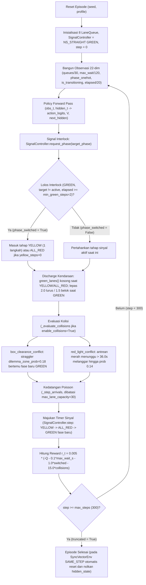

# Panduan Lengkap Siklus Episode, Loop Training PPO, dan Penelusuran Simulasi

Dokumen ini menjelaskan secara faktual alur lengkap satu episode simulasi lalu lintas (`300` langkah), mekanisme training PPO vektorisasi di CPU beserta **Live Policy Preview** pada Web UI, serta penelusuran nyata satu episode penuh dari `step=0` hingga `step=300` menggunakan kode dan *checkpoint* aktual di repositori ini.

Untuk daftar lengkap simbol persamaan dan pemetaan nama variabel kode, lihat [VARIABLES_AND_MATH.md](VARIABLES_AND_MATH.md).

---

## 1. Gambaran Umum 1 Episode Penuh (300 Langkah = 10 Menit Simulasi)

Setiap episode pada `TrafficIntersectionEnv` (`src/fly_traffic/environment/traffic_env.py`) berdurasi tetap `max_steps = 300` langkah diskrit dengan interval waktu `dt_seconds = 2.0` detik per langkah (`TrafficEnvConfig` di `src/fly_traffic/config.py`). Total durasi simulasi dalam 1 episode adalah:

$$300 \text{ langkah} \times 2.0 \text{ s/langkah} = 600 \text{ detik} = 10 \text{ menit simulasi}$$

Persimpangan memiliki 4 arah dengan 2 lajur per arah (`NUM_LANES = 8`, indeks `0..7` pada `LaneId` di `src/fly_traffic/environment/intersection_state.py`), yaitu `N_STRAIGHT (0)`, `N_TURN (1)`, `S_STRAIGHT (2)`, `S_TURN (3)`, `E_STRAIGHT (4)`, `E_TURN (5)`, `W_STRAIGHT (6)`, dan `W_TURN (7)`. Setiap lajur bertipe antrean FIFO (`LaneQueue`) berkapasitas maksimum `max_lane_capacity = 30` kendaraan. Kendaraan yang keluar saat lampu hijau mengikuti kapasitas pelepasan `straight_discharge_rate = 2.0` kendaraan/langkah untuk lajur lurus dan `turn_discharge_rate = 1.5` kendaraan/langkah untuk lajur belok (`1` atau `2` kendaraan secara stokastik pada `_sample_discharge_capacity`). Agen memilih satu dari `NUM_PHASES = 4` fase sinyal non-konflik (`SignalPhase`): `0: NS Straight` (lajur `0, 2`), `1: NS Turn` (lajur `1, 3`), `2: EW Straight` (lajur `4, 6`), dan `3: EW Turn` (lajur `5, 7`).

### A. Perbedaan Kondisi Training (`mixed`) vs Benchmark Deterministik

Pada `TrafficProfileFactory` (`src/fly_traffic/environment/traffic_profiles.py`), distribusi kedatangan kendaraan berbasis proses *Poisson* berbeda antara fase training dan fase evaluasi benchmark:

| Aspek | Mode Training (`profile_name="mixed"`) | Mode Benchmark (`AgentEvaluator`) |
|---|---|---|
| **Konfigurasi Default** | `TrafficEnvConfig.profile_name = "mixed"` (dipakai oleh 8 env paralel di `PPOTrainer`) | `BenchmarkConfig.scenarios = ("normal", "asymmetric", "rush_hour")` pada 10 seed (`1000..1009`) |
| **Pemilihan Skenario per Episode** | Setiap `reset()` memilih acak seragam satu dari 4 template: `normal`, `asymmetric`, `asymmetric_ew`, atau `rush_hour` | Skenario tetap dan deterministik per rangkaian evaluasi |
| **Jitter Laju Kedatangan** | Dikalikan faktor acak `scale ~ Uniform(0.85, 1.15)` (`0.85x - 1.15x`) per episode | Tanpa jitter (`rate_scale = 1.0`) |
| **Tujuan** | Mencegah *overfitting* pada satu arah kepadatan dan menjaga generalisasi kebijakan rekuren | Mengukur perbandingan adil antar agen (`Fixed Timer`, `PPO-MLP`, `PPO-GRU`, `Fly Connectome PPO`) |

Rincian laju kedatangan Poisson dasar ($\lambda$ kendaraan per langkah sebelum faktor skala) tiap profil adalah:

1. **`normal`**: Aliran seimbang ringan-sedang di seluruh pendekatan (`ns_straight=0.12`, `ns_turn=0.06`, `ew_straight=0.12`, `ew_turn=0.06`).
2. **`asymmetric`**: Koridor Utara-Selatan padat berkelanjutan vs Timur-Barat ringan (`ns_straight=0.34`, `ns_turn=0.14`, `ew_straight=0.06`, `ew_turn=0.04`).
3. **`asymmetric_ew`** *(hanya di dalam campuran `mixed`)*: Kebalikan dari `asymmetric`, koridor Timur-Barat padat berkelanjutan (`ns_straight=0.06`, `ns_turn=0.04`, `ew_straight=0.34`, `ew_turn=0.14`) agar kebijakan terlatih simetris terhadap kedua sumbu jalan.
4. **`rush_hour`**: Profil dinamis 3-regime dalam 1 episode (`max_steps = 300`):
   - **Regime 1 (Langkah `0..99`)**: Seimbang moderat `[0.14, 0.07, 0.14, 0.07, 0.14, 0.07, 0.14, 0.07]`.
   - **Regime 2 (Langkah `100..199`)**: Lonjakan Utara-Selatan (*NS surge*) `[0.38, 0.16, 0.38, 0.16, 0.08, 0.04, 0.08, 0.04]`.
   - **Regime 3 (Langkah `200..299`)**: Lonjakan Timur-Barat (*EW surge*) `[0.08, 0.04, 0.08, 0.04, 0.38, 0.16, 0.38, 0.16]`.

### B. Anatomi 1 Episode Penuh

Diagram berikut memetakan urutan eksekusi aktual di dalam `TrafficIntersectionEnv.reset()` dan `TrafficIntersectionEnv.step()`:

---

## 2. Alur Loop Training PPO & Live Policy Preview

Training dijalankan 100% di CPU melalui `PPOTrainer` (`src/fly_traffic/training/ppo_trainer.py`) dan dikelola secara non-blocking dari antarmuka web oleh `TrainingJobManager` (`src/fly_traffic/web/training_service.py`).

### A. Arsitektur Loop Training PPO Vektorisasi & Sequence-Chunked

Konfigurasi default `PPOConfig` menggunakan `num_envs = 8`, `rollout_steps = 128` (`1.024` langkah per update PPO), `sequence_chunk_len = 16` (`64` chunk per update), `num_minibatches = 4` (`16` chunk atau `256` langkah per minibatch), dan `update_epochs = 4` (`16` langkah optimasi Adam per update).

### B. Interaksi Satu Langkah (*Single-Step Sequence Diagram*)

Diagram urutan berikut memperlihatkan bagaimana satu tick rollout berjalan di antara `PPOTrainer`, `FlyConnectomePolicy`, `TrafficIntersectionEnv`, `SignalController`, dan `RecurrentRolloutBuffer`:

### C. Mengapa Training Berjalan *Headless* Jauh Lebih Cepat dibanding Pemutaran Visual, dan Peran Live Policy Preview

1. **Kecepatan Training Headless di CPU vs Simulasi Visual Real-Time**:
   - Pada tab **Live Simulation** (`SimulationService` di `src/fly_traffic/web/simulation_service.py`), simulasi sengaja dibatasi *timer* pemutaran manusia `steps_per_second` (`0.5 .. 8.0` steps/s pada slider UI, default `2.0` steps/s) dan pada setiap langkah menyandikan vektor aktivasi `2.500` neuron ke format base64 untuk dirender di browser pada Canvas 2D 60 FPS. Jika training menunggu laju visual `2.0` steps/s, 1 update PPO (`1.024` langkah) akan memakan waktu `512` detik (~8,5 menit), dan `163.840` langkah akan memakan waktu hampir `23` jam.
   - Sebaliknya, `PPOTrainer` berjalan 100% *headless* menggunakan 8 environment vektor sinkron (`SyncVectorEnv`) tanpa render grafis dan tanpa jeda waktu nyata. Pengukuran langsung di CPU pada sesi ini (2 update = `2.048` langkah, `save_checkpoint=False`) mencatat kecepatan:
     - **`FlyConnectomePolicy`** (`2.500` neuron *sparse*, `70.006` parameter terlatih): **`369.2 - 394.4` steps/s** per update (`299.8` steps/s total termasuk inisialisasi, `6.832` detik untuk `2.048` langkah).
     - **`GRUBaselinePolicy`** (`69.725` parameter terlatih): **`1,060.1 - 1,136.2` steps/s** per update (`1,131.2` steps/s total, `1.810` detik untuk `2.048` langkah).
     - **`MLPBaselinePolicy`** (`69.755` parameter terlatih): **`2,487.3 - 2,594.8` steps/s** per update (`2,450.2` steps/s total, `0.836` detik untuk `2.048` langkah).
2. **Cara Kerja Live Policy Preview Tanpa Memperlambat Training**:
   - Di awal pekerjaan training (`TrainingJobManager._run_worker`), backend membuat satu environment evaluasi ringan terpisah: `preview_env = TrafficIntersectionEnv(config=TrafficEnvConfig(profile_name="rush_hour"))`.
   - Setiap kali `PPOTrainer` menyelesaikan 1 update (`1.024` langkah rollout + 4 epoch optimasi), callback `on_policy_update_callback` memanggil `TrainingJobManager._rollout_preview_frames(..., num_ticks=4)`.
   - Fungsi ini menjalankan hanya **4 langkah deterministik** (`torch.argmax(logits, dim=-1)` dalam blok `torch.no_grad()` dan mode `policy.eval()`) serta memanggil `preview_env.get_render_snapshot()`. Pengukuran langsung pada sesi ini menunjukkan 4 tick preview untuk `FlyConnectomePolicy` hanya memakan **`10.33 ms`** per update (dibandingkan ~`2.6` detik per update training Fly).
   - Keempat snapshot JSON tersebut dikirim melalui field `preview_frames` pada event WebSocket `training_update` (`/ws/training`). Di sisi browser, `TrainingStudioView` (`frontend/js/training_studio.js`) memutar ulang antrean 4 frame tersebut satu per satu setiap `previewIntervalMs = 260` ms melalui `IntersectionRenderer` (`{ compact: true }`) selama tab Training Studio aktif terlihat, menampilkan pergerakan kendaraan, lampu 3-lensa, dan penghitung `Collisions` secara *live* tanpa menyentuh maupun memperlambat loop rollout PPO.

---

## 3. Penelusuran Nyata 1 Episode Penuh (Step 0 .. Step 300)

Seluruh angka pada bagian ini berasal langsung dari eksekusi skrip Python read-only menggunakan `/cache/ml/.venv/bin/python` terhadap *checkpoint* terlatih `artifacts/checkpoints/fly_ppo.pt` (`trained_timesteps = 163,840`, `trainable_params = 70,006`, `leak_rate_tau = 0.4328`) dan artefak sub-connectome `artifacts/fly_subconnectome.pt` (`2,500` neuron: `1,800` CX + `700` MB; `36,908` sisi eksitatori + `50,263` sisi inhibitori; *sparsity* `98.6053%`).

### A. Jejak Episode Utama: `Fly Connectome PPO` pada `rush_hour` (`seed=1001`, `all_red_steps=1`)

Pada konfigurasi default (`all_red_steps=1`, `yellow_steps=1`, `min_green_steps=2`), agen memulai episode di fase `0 (NS Straight)` dengan seluruh antrean kosong (`step=0`). Tabel berikut mencatat kondisi nyata pada *milestone* `step = 0, 1, 30, 100, 150, 200, 250, 300`:

| Step | Fase Aktif & Stage | Aksi / Switch | Antrean 8 Lajur `[N_S, N_T, S_S, S_T, E_S, E_T, W_S, W_T]` | Total Queue | Arr / Dep Step | Total Throughput | Total Switches | Max Wait (s) | Mean Wait (s) | Step Reward | Episode Return | Total Collisions | Probabilitas Aksi `[P0, P1, P2, P3]` & `V(s_t)` |
|---:|---|---|---|---:|---|---:|---:|---:|---:|---:|---:|---:|---|
| **0** | `0: NS Straight` (`GREEN`) | Reset | `[0, 0, 0, 0, 0, 0, 0, 0]` | 0 | `-` | 0 | 0 | 0.0 | 0.00 | - | 0.0000 | 0 | Awal episode (`obs_sum = 1.0000`) |
| **1** | `0: NS Straight` (`GREEN`) | `0` (`False`) | `[0, 0, 0, 0, 0, 0, 0, 0]` | 0 | `0 / 0` | 0 | 0 | 0.0 | 0.00 | -0.0000 | 0.0000 | 0 | `[0.343, 0.183, 0.140, 0.334]`, `V=-1.826` |
| **30** | `2: EW Straight` (`GREEN`) | `2` (`False`) | `[0, 0, 0, 0, 3, 3, 2, 1]` | 9 | `1 / 0` | 11 | 6 | 26.0 | 13.09 | -0.0580 | -0.8540 | 0 | `[0.002, 0.001, 0.919, 0.079]`, `V=-4.242` |
| **100** | `1: NS Turn` (`GREEN`) | `0` (`False`) | `[2, 1, 2, 3, 1, 2, 1, 1]` | 13 | `1 / 0` | 75 | 23 | 28.0 | 15.28 | -0.0790 | -4.3940 | 0 | `[0.467, 0.416, 0.100, 0.017]`, `V=-4.606` |
| **150** | `0: NS Straight` (`GREEN`) | `0` (`False`) | `[2, 3, 1, 1, 1, 0, 0, 1]` | 9 | `1 / 4` | 154 | 33 | 38.0 | 16.18 | -0.0640 | -8.4460 | 0 | `[0.996, 0.000, 0.000, 0.004]`, `V=-4.920` |
| **200** | `1: NS Turn` (`GREEN`) | `0` (`False`) | `[1, 0, 5, 0, 1, 0, 0, 0]` | 7 | `0 / 2` | 207 | 44 | 26.0 | 16.43 | -0.0480 | -11.6720 | 0 | `[0.831, 0.165, 0.003, 0.001]`, `V=-4.417` |
| **250** | `2: EW Straight` (`GREEN`) | `2` (`False`) | `[0, 0, 1, 0, 4, 0, 3, 0]` | 8 | `1 / 4` | 275 | 55 | 14.0 | 15.96 | -0.0470 | -15.0590 | 0 | `[0.001, 0.000, 0.999, 0.001]`, `V=-4.306` |
| **300** | `2: EW Straight` (`GREEN`) | `2` (`False`) | `[0, 1, 1, 2, 1, 0, 3, 1]` | 9 | `1 / 0` | 336 | 67 | 26.0 | 15.21 | -0.0580 | -17.6850 | 0 | `[0.030, 0.096, 0.858, 0.016]`, `V=-4.238` |

**Ringkasan Akhir Episode Utama (`rush_hour`, `seed=1001`, `all_red_steps=1`)**:
- `total_reward`: `-17.6850`
- `mean_queue`: `8.66` kendaraan
- `mean_wait_time_s` (termasuk kendaraan tersisa di akhir episode): `15.06` s
- `total_throughput`: `336` kendaraan
- `total_switches`: `67` perpindahan fase
- `total_collisions`: **`0`** (`red_light_conflict = 0`, `box_clearance_conflict = 0`)
- Status terminasi: `truncated = True`, `terminated = False`

#### Mekanisme Interlock Sinyal pada Pergantian Fase Pertama (Langkah `7..12`)

Tabel berikut menampilkan jejak langkah demi langkah di sekitar pergantian fase pertama (`NS Straight -> NS Turn -> EW Straight`) untuk menunjukkan cara kerja `decision_mask`, `YELLOW`, `ALL_RED`, dan `min_green_steps = 2`:

| Step | `decision_mask` Sebelum Step | Aksi Policy | `phase_switched` | Fase & Stage di Akhir Step | `phase_elapsed` di `obs[21]` Berikutnya | Arr / Dep | Reward | Keterangan Mekanisme |
|---:|---:|---:|---:|---|---:|---|---:|---|
| **7** | `1` | `0` (`NS Straight`) | `False` | `0: NS Straight` (`GREEN`) | `7` | `1 / 0` | `-0.0210` | Tetap melayani `NS Straight` |
| **8** | `1` | `1` (`NS Turn`) | `True` | `0: NS Straight` (`ALL_RED`) | `7` | `1 / 0` | `-0.0320` | `request_phase(1)` masuk `YELLOW` (sehingga `dep=0`), lalu `signal.step()` memajukan ke `ALL_RED`; penalti switch `-0.005` aktif |
| **9** | `0` | `0` | `False` | `1: NS Turn` (`GREEN`) | `0` | `1 / 0` | `-0.0330` | `ALL_RED` mengunci pelepasan (`dep=0`) & membiarkan straggler bersih sebelum `signal.step()` mengaktifkan `1: NS Turn` (`GREEN`) |
| **10** | `0` | `1` | `False` | `1: NS Turn` (`GREEN`) | `1` | `1 / 1` | `-0.0330` | Langkah hijau ke-1 `NS Turn` (`dep=1`); `elapsed=0 -> 1 < min_green_steps (2)` |
| **11** | `0` | `2` (`EW Straight`) | `False` | `1: NS Turn` (`GREEN`) | `2` | `0 / 1` | `-0.0250` | Policy meminta fase `2`, tetapi ditolak interlock karena `elapsed=1 < 2` (`decision_mask=0` selama training) |
| **12** | `1` | `2` (`EW Straight`) | `True` | `1: NS Turn` (`ALL_RED`) | `2` | `0 / 0` | `-0.0310` | `elapsed=2 >= min_green_steps`: switch ke `EW Straight` diterima |

### B. Uji Tekanan (*Stress Test*) & Perbandingan Kolisi Nyata pada `rush_hour`

Untuk menguji fungsi proteksi *safety buffer* dan perilaku kontroler di bawah beban puncak, tabel di bawah merangkum eksekusi nyata di `TrafficIntersectionEnv` pada `rush_hour` (`seed=1001` serta rata-rata 10 seed `1000..1009`):

| Agen & Kondisi | `all_red_steps` | `seed=1001` Total Reward | `seed=1001` Mean Queue | `seed=1001` Mean Wait (s) | `seed=1001` Throughput | `seed=1001` Switches | `seed=1001` Collisions (`red_light` / `box_clearance`) | 10-Seed (`1000..1009`) Mean Collisions |
|---|---:|---:|---:|---:|---:|---:|---|---|
| **Fly Connectome PPO (Default)** | `1` | `-17.6850` | `8.66` | `15.06` | `336` | `67` | **`0`** (`0` / `0`) | **`0.30`** (`[0,0,0,0,1,1,1,0,0,0]`) |
| **Fly Connectome PPO (CX Lesion 25%)** | `1` | `-18.4670` | `9.45` | `16.49` | `331` | `68` | **`0`** (`0` / `0`) | *Tidak diukur pada skrip ini* |
| **Fly Connectome PPO (Stress: `set_safety_buffer(0)`)** | `0` | `-12.6310` | `6.09` | `10.45` | `341` | `87` | **`6`** (`0` / `6`) | **`9.60`** (`[11,6,10,8,11,10,16,11,6,7]`) |
| **Fixed Timer (Rule-Based, `8,4,8,4`)** | `1` | `-32.9000` | `16.85` | `27.93` | `341` | `37` | **`3`** (`3` / `0`) | **`1.60`** (`[0,3,2,1,1,1,4,2,1,1]`) |
| **Fixed Timer (Stress: `all_red_steps=0`)** | `0` | `-25.0810` | `12.58` | `20.57` | `347` | `42` | **`8`** (`1` / `7`) | **`4.60`** (`[1,8,2,5,1,7,12,6,2,2]`) |

**Temuan Mekanistik dari Uji Tekanan**:
1. **Peran `all_red_steps = 1` pada `box_clearance_conflict`**: Saat `phase_switched = True`, kendaraan yang baru melepas pada langkah sebelumnya berpeluang `dilemma_zone_prob = 0.18` tertinggal di kotak persimpangan dengan sisa umur `2` langkah di `_box_stragglers`. Dengan konfigurasi default (`yellow_steps=1` + `all_red_steps=1`), dua langkah jeda tanpa pelepasan menghabiskan sisa umur `2 -> 1 -> 0` sebelum fase baru mendapat lampu `GREEN`. Ketika `set_safety_buffer(0)` mematikan `ALL_RED`, fase baru sudah aktif `GREEN` saat `remaining_steps = 1`, sehingga pada `seed=1001` memicu **6 `box_clearance_conflict`** (pada langkah `73, 83, 86, 122, 160, 262`) dan rata-rata **`9.60` kolisi/episode** di 10 seed.
2. **Kegagalan `Fixed Timer` terhadap `red_light_conflict`**: Meskipun `all_red_steps = 1` melindungi persimpangan dari `box_clearance_conflict`, jadwal statis `(8, 4, 8, 4)` tidak merespons penumpukan lajur tertentu selama fase *NS surge* dan *EW surge* (`max_wait_s` mencapai `98.0 s` di langkah `200`). Pada `seed=1001`, hal ini memicu **3 `red_light_conflict`** (langkah `187` oleh lajur `3` setelah menunggu `78.0 s`, langkah `225` oleh lajur `3` setelah `94.0 s`, dan langkah `247` oleh lajur `7` setelah `46.0 s`). Sebaliknya, `Fly Connectome PPO` mengubah fase secara adaptif (`67` vs `37` switch) sehingga menjaga `red_light_conflict = 0` pada `seed=1001` dan rata-rata `0.30` kolisi di seluruh 10 seed.
3. **Ketangguhan terhadap Lesi CX 25%**: Mematikan 25% neuron Central Complex (`450` dari `1.800` neuron CX, menyisakan `2.050` neuron aktif) pada `seed=1001` meningkatkan antrean rata-rata dari `8.66` menjadi `9.45` dan waktu tunggu dari `15.06 s` menjadi `16.49 s`, tetapi tetap mempertahankan `total_collisions = 0`.
