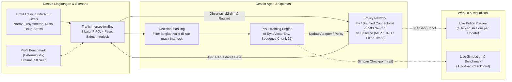
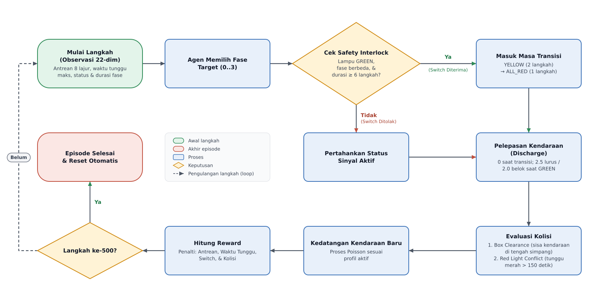
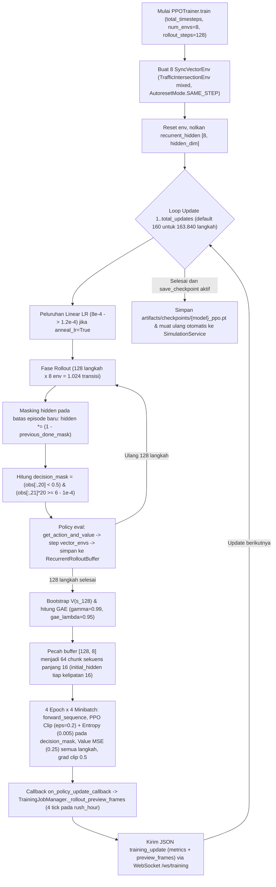
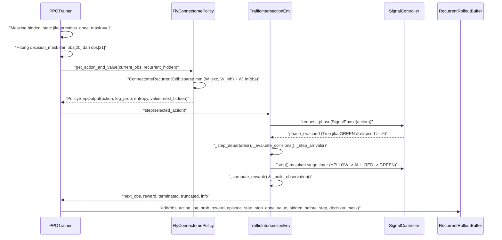

# Panduan Siklus Episode, Arsitektur Sistem, dan Loop Training PPO

Dokumen ini menjelaskan arsitektur interaksi antar-komponen sistem, alur satu episode simulasi lalu lintas (`500` langkah pada `src/fly_traffic/config.py`), serta mekanisme pelatihan PPO vektorisasi di CPU beserta **Live Policy Preview** pada Web UI.

Untuk pemetaan simbol persamaan ke atribut kode, lihat [VARIABLES_AND_MATH.md](VARIABLES_AND_MATH.md). Untuk laporan teknis dan hasil benchmark menyeluruh, lihat [technical_report.pdf](technical_report.pdf).

---

## Gambaran Arsitektur Sistem (*High-Level Dataflow*)

---

## 1. Gambaran Umum 1 Episode Penuh (500 Langkah = 1.000 Detik Simulasi)

Setiap episode pada `TrafficIntersectionEnv` (`src/fly_traffic/environment/traffic_env.py`) berdurasi tetap `max_steps = 500` langkah diskrit dengan interval waktu `dt_seconds = 2.0` detik per langkah (`TrafficEnvConfig` di `src/fly_traffic/config.py`). Total durasi simulasi dalam 1 episode adalah:

$$500 \text{ langkah} \times 2.0 \text{ s/langkah} = 1.000 \text{ detik} \approx 16 \text{ menit } 40 \text{ detik simulasi}$$

Persimpangan memiliki 4 arah dengan 2 lajur per arah (`NUM_LANES = 8`, indeks `0..7` pada `LaneId` di `src/fly_traffic/environment/intersection_state.py`), yaitu `N_STRAIGHT (0)`, `N_TURN (1)`, `S_STRAIGHT (2)`, `S_TURN (3)`, `E_STRAIGHT (4)`, `E_TURN (5)`, `W_STRAIGHT (6)`, dan `W_TURN (7)`. Setiap lajur bertipe antrean FIFO (`LaneQueue`) berkapasitas maksimum `max_lane_capacity = 30` kendaraan (observasi antrean dibagi `30.0`, sedangkan mode interaktif `Live Simulation` memakai `hard_max_lane_capacity = 80`). Kendaraan yang keluar saat lampu hijau mengikuti kapasitas pelepasan `straight_discharge_rate = 2.5` kendaraan/langkah (`2` atau `3` kendaraan secara stokastik pada `_sample_discharge_capacity`) dan `turn_discharge_rate = 2.0` kendaraan/langkah. Agen memilih satu dari `NUM_PHASES = 4` fase sinyal non-konflik (`SignalPhase`): `0: NS Straight` (lajur `0, 2`), `1: NS Turn` (lajur `1, 3`), `2: EW Straight` (lajur `4, 6`), dan `3: EW Turn` (lajur `5, 7`).

### A. Perbedaan Kondisi Training (`mixed`) vs Benchmark Deterministik

Pada `TrafficProfileFactory` (`src/fly_traffic/environment/traffic_profiles.py`), distribusi kedatangan kendaraan berbasis proses *Poisson* berbeda antara fase training dan fase evaluasi benchmark:

| Aspek | Mode Training (`profile_name="mixed"`) | Mode Benchmark (`AgentEvaluator`) |
|---|---|---|
| **Konfigurasi Default** | `TrafficEnvConfig.profile_name = "mixed"` (dipakai oleh 8 env paralel di `PPOTrainer`) | `BenchmarkConfig.scenarios = ("normal", "asymmetric", "rush_hour", "stress_test")` pada 50 seed (`1000..1049`) |
| **Pemilihan Skenario per Episode** | Setiap `reset()` memilih acak terbobot: `normal`, `asymmetric`, `asymmetric_ew`, `rush_hour` (`2/9` tiap template) dan `stress_train` (`1/9`) | Skenario tetap dan deterministik per rangkaian evaluasi |
| **Jitter Laju Kedatangan** | Dikalikan faktor acak `scale ~ Uniform(0.85, 1.15)` (kecuali `stress_train` yang memakai batas seragam tersendiri) | Tanpa jitter (`rate_scale = 1.0`) |
| **Tujuan** | Mencegah *overfitting* pada satu arah kepadatan dan melatih ketahanan terhadap lonjakan beban | Mengukur perbandingan adil antar agen (`Fixed Timer`, `PPO-MLP`, `PPO-GRU`, `Shuffled Connectome`, `Fly Connectome PPO`) |

Rincian laju kedatangan Poisson dasar ($\lambda$ kendaraan per langkah sebelum faktor skala) tiap profil adalah:

1. **`normal`**: Aliran seimbang ringan-sedang di seluruh pendekatan (`ns_straight=0.12`, `ns_turn=0.06`, `ew_straight=0.12`, `ew_turn=0.06`).
2. **`asymmetric`**: Koridor Utara-Selatan padat berkelanjutan vs Timur-Barat ringan (`ns_straight=0.34`, `ns_turn=0.14`, `ew_straight=0.06`, `ew_turn=0.04`).
3. **`asymmetric_ew`** *(di dalam campuran `mixed`)*: Kebalikan dari `asymmetric`, koridor Timur-Barat padat berkelanjutan (`ns_straight=0.06`, `ns_turn=0.04`, `ew_straight=0.34`, `ew_turn=0.14`).
4. **`rush_hour`**: Profil dinamis 3-regime dalam 1 episode (`max_steps = 500`, batas potong `166` dan `333`):
   - **Regime 1 (Langkah `0..165`)**: Moderat seimbang `[0.22, 0.10, 0.22, 0.10, 0.22, 0.10, 0.22, 0.10]`.
   - **Regime 2 (Langkah `166..332`)**: Lonjakan Utara-Selatan (*NS surge*) `[0.56, 0.24, 0.56, 0.24, 0.16, 0.08, 0.16, 0.08]`.
   - **Regime 3 (Langkah `333..499`)**: Lonjakan Timur-Barat (*EW surge*) `[0.16, 0.08, 0.16, 0.08, 0.56, 0.24, 0.56, 0.24]`.
5. **`stress_train`** *(di dalam campuran `mixed`)*: Beban tinggi acak (`ns_s/ew_s ~ Uniform(0.38, 0.46)`, `ns_t/ew_t ~ Uniform(0.22, 0.28)`).
6. **`stress_test`**: Beban ekstrem konstan untuk benchmark saturasi (`ns_straight=0.50`, `ns_turn=0.40`, `ew_straight=0.50`, `ew_turn=0.40`).

### B. Anatomi 1 Episode Penuh

Flowchart berikut memetakan urutan eksekusi aktual di dalam `TrafficIntersectionEnv.reset()` dan `TrafficIntersectionEnv.step()`:

---

## 2. Alur Loop Training PPO & Live Policy Preview

Training dijalankan 100% di CPU melalui `PPOTrainer` (`src/fly_traffic/training/ppo_trainer.py`) dan dikelola secara non-blocking dari antarmuka web oleh `TrainingJobManager` (`src/fly_traffic/web/training_service.py`).

### A. Arsitektur Loop Training PPO Vektorisasi & Sequence-Chunked

Konfigurasi default `PPOConfig` menggunakan `num_envs = 8`, `rollout_steps = 128` (`1.024` langkah per update PPO), `sequence_chunk_len = 16` (`64` chunk per update), `num_minibatches = 4` (`16` chunk atau `256` langkah per minibatch), dan `update_epochs = 4` (`16` langkah optimasi Adam per update).

### B. Interaksi Satu Langkah (*Single-Step Sequence Diagram*)

Diagram urutan berikut memperlihatkan bagaimana satu tick rollout berjalan di antara `PPOTrainer`, `FlyConnectomePolicy`, `TrafficIntersectionEnv`, `SignalController`, dan `RecurrentRolloutBuffer`:

### C. Mengapa Training Berjalan *Headless* Jauh Lebih Cepat dibanding Pemutaran Visual, dan Peran Live Policy Preview

1. **Kecepatan Training Headless di CPU vs Simulasi Visual Real-Time**:
   - Pada tab **Live Simulation** (`SimulationService` di `src/fly_traffic/web/simulation_service.py`), simulasi sengaja dibatasi *timer* pemutaran manusia `steps_per_second` (`0.5 .. 8.0` steps/s pada slider UI, default `2.0` steps/s) dan pada setiap langkah menyandikan vektor aktivasi `2.500` neuron ke format base64 untuk dirender di browser pada Canvas 2D 60 FPS. Jika training menunggu laju visual `2.0` steps/s, 1 update PPO (`1.024` langkah) akan memakan waktu `512` detik (~8,5 menit), dan `163.840` langkah akan memakan waktu hampir `23` jam.
   - Sebaliknya, `PPOTrainer` berjalan 100% *headless* menggunakan 8 environment vektor sinkron (`SyncVectorEnv`) tanpa render grafis dan tanpa jeda waktu nyata. Pengukuran langsung di CPU pada sesi ini (2 update = `2.048` langkah, `save_checkpoint=False`) mencatat kecepatan:
     - **`FlyConnectomePolicy`** (`2.500` neuron *sparse*, `70.006` parameter terlatih): **`369.2 - 394.4` steps/s** per update (`299.8` steps/s total termasuk inisialisasi, `6.832` detik untuk `2.048` langkah).
     - **`GRUBaselinePolicy`** (`69.725` parameter terlatih): **`1,060.1 - 1,136.2` steps/s** per update (`1,131.2` steps/s total, `1.810` detik untuk `2.048` langkah).
     - **`MLPBaselinePolicy`** (`69.755` parameter terlatih): **`2,487.3 - 2,594.8` steps/s** per update (`2,450.2` steps/s total, `0.836` detik untuk `2.048` langkah).
2. **Cara Kerja Live Policy Preview Tanpa Memperlambat Training**:
   - Di awal pekerjaan training (`TrainingJobManager._run_worker`), backend membuat satu environment evaluasi ringan terpisah: `preview_env = TrafficIntersectionEnv(config=TrafficEnvConfig(profile_name="rush_hour"))`.
   - Setiap kali `PPOTrainer` menyelesaikan 1 update (`1.024` langkah rollout + 4 epoch optimasi), callback `on_policy_update_callback` memanggil `TrainingJobManager._rollout_preview_frames(..., num_ticks=4)`.
   - Fungsi ini menjalankan hanya **4 langkah deterministik** (`torch.argmax(logits, dim=-1)` dalam blok `torch.no_grad()` dan mode `policy.eval()`) serta memanggil `preview_env.get_render_snapshot()`. Pengukuran langsung pada sesi ini menunjukkan 4 tick preview untuk `FlyConnectomePolicy` hanya memakan **`10.33 ms`** per update (dibandingkan ~`2.6` detik per update training Fly).
   - Keempat snapshot JSON tersebut dikirim melalui field `preview_frames` pada event WebSocket `training_update` (`/ws/training`). Di sisi browser, `TrainingStudioView` (`frontend/js/training_studio.js`) memutar ulang antrean 4 frame tersebut satu per satu setiap `previewIntervalMs = 260` ms melalui `IntersectionRenderer` (`{ compact: true }`) selama tab Training Studio aktif terlihat, menampilkan pergerakan kendaraan, lampu 3-lensa, dan penghitung `Collisions` secara *live* tanpa menyentuh maupun memperlambat loop rollout PPO.
