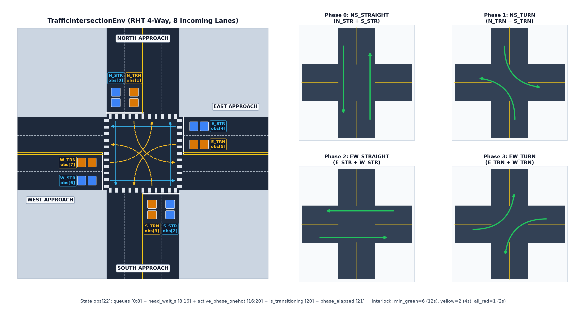
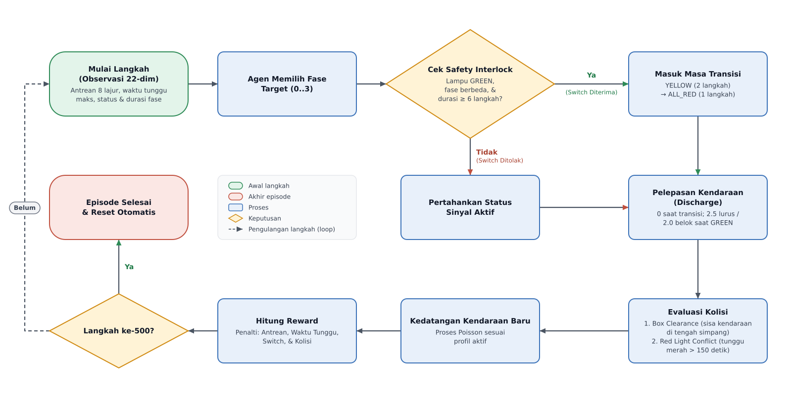

# Lingkungan Simulasi Persimpangan (`src/fly_traffic/environment/`)





## 1. Pemetaan Lajur (`LaneId`) & Fase Sinyal (`SignalPhase`)

| Indeks Lajur (`LaneId`) | Lajur Masuk | Fase Aktif (`SignalPhase`) | Lajur Konflik (`CONFLICTING_LANES`) |
|---|---|---|---|
| `0` | `N_STRAIGHT` | `0` (`NS_STRAIGHT`) | `{3: S_TURN, 4: E_STRAIGHT, 6: W_STRAIGHT, 7: W_TURN}` |
| `1` | `N_TURN` | `1` (`NS_TURN`) | `{2: S_STRAIGHT, 4: E_STRAIGHT, 5: E_TURN, 7: W_TURN}` |
| `2` | `S_STRAIGHT` | `0` (`NS_STRAIGHT`) | `{1: N_TURN, 4: E_STRAIGHT, 5: E_TURN, 6: W_STRAIGHT}` |
| `3` | `S_TURN` | `1` (`NS_TURN`) | `{0: N_STRAIGHT, 5: E_TURN, 6: W_STRAIGHT, 7: W_TURN}` |
| `4` | `E_STRAIGHT` | `2` (`EW_STRAIGHT`) | `{0: N_STRAIGHT, 1: N_TURN, 2: S_STRAIGHT, 7: W_TURN}` |
| `5` | `E_TURN` | `3` (`EW_TURN`) | `{1: N_TURN, 2: S_STRAIGHT, 3: S_TURN, 6: W_STRAIGHT}` |
| `6` | `W_STRAIGHT` | `2` (`EW_STRAIGHT`) | `{0: N_STRAIGHT, 2: S_STRAIGHT, 3: S_TURN, 5: E_TURN}` |
| `7` | `W_TURN` | `3` (`EW_TURN`) | `{0: N_STRAIGHT, 1: N_TURN, 3: S_TURN, 4: E_STRAIGHT}` |

Setiap lajur dikelola oleh `LaneQueue` berbasis `collections.deque[int]` yang menyimpan indeks langkah kedatangan kendaraan untuk menghitung waktu tunggu kepala antrean (`(current_step - self._arrivals[0]) * dt_seconds`).

---

## 2. Mesin State & Safety Interlock (`SignalController`)

Pergantian fase hanya diterima saat stage `GREEN`, target berbeda dari `active_phase`, dan `phase_elapsed >= min_green_steps` (`6` langkah = `12.0 s`):

```python
def request_phase(self, target_phase: SignalPhase) -> bool:
    if self.is_transitioning or target_phase == self.active_phase:
        return False
    if self.phase_elapsed < self.min_green_steps:
        return False
    self.pending_phase = target_phase
    if self.yellow_steps > 0:
        self.stage = SignalStage.YELLOW
        self.stage_elapsed = 0
    elif self.all_red_steps > 0:
        self.stage = SignalStage.ALL_RED
        self.stage_elapsed = 0
    else:
        self._activate_pending_phase()
    return True
```

Selama `stage` bernilai `YELLOW` (`2` langkah) atau `ALL_RED` (`1` langkah), `green_lanes()` mengembalikan tuple kosong `()` sehingga tidak ada kendaraan yang dilepaskan.

---

## 3. Vektor Observasi 22-Dimensi (`_build_observation`)

| Rentang Indeks | Sumber Variabel | Rumus Normalisasi | Rentang Nilai |
|---|---|---|---|
| `obs[0:8]` | `lane.length` | `min(lane.length / queue_obs_norm_capacity, 2.0)` (`norm=30.0`) | `[0.0, 2.0]` |
| `obs[8:16]` | `lane.max_wait_seconds(...)` | `min(wait_s / max_wait_norm_seconds, 2.0)` (`norm=150.0`) | `[0.0, 2.0]` |
| `obs[16:20]` | `self._signal.active_phase` | *One-hot* fase `0..3` | `{0.0, 1.0}` |
| `obs[20]` | `self._signal.is_transitioning` | `1.0` saat `YELLOW` / `ALL_RED`, `0.0` saat `GREEN` | `{0.0, 1.0}` |
| `obs[21]` | `self._signal.phase_elapsed` | `min(phase_elapsed / max_elapsed_norm_steps, 2.0)` (`norm=20.0`) | `[0.0, 2.0]` |

*(Batas `queue_obs_norm_capacity = 30.0` sengaja dipisahkan dari `hard_max_lane_capacity = 80` agar suntikan kendaraan manual hingga 80/lajur di Live Simulation tetap terjepit ke `[0.0, 2.0]` tanpa merusak skala input kebijakan terlatih.)*

---

## 4. Fungsi Reward & Fisika Kolisi (`_compute_reward`, `_evaluate_collisions`)

```python
raw_reward = (
    -float(total_queue)
    - self.config.wait_penalty_alpha * float(max_wait_s)
    - self.config.switch_penalty_beta * float(phase_switched)
    - self.config.collision_penalty * float(collision_count)
)
return float(raw_reward * self.config.reward_scale)
```

| Mekanisme Kolisi | Kondisi Pemicu | Probabilitas & Efek |
|---|---|---|
| `box_clearance_conflict` | Saat `phase_switched = True`, lajur yang baru saja melepas kendaraan berpeluang `dilemma_zone_prob = 0.18` menyisakan `[lane_index, 2]` di `self._box_stragglers`. | Jika lajur berkonflik di `CONFLICTING_LANES` sudah mulai melepas selagi `remaining_steps > 0` (terjadi jika total jeda `yellow_steps + all_red_steps < 2`), tercatat 1 konflik. |
| `red_light_conflict` | Saat stage `GREEN` dan ada lajur hijau yang melepas kendaraan, lajur merah berkonflik yang kepalanya menunggu `head_wait_s > red_light_wait_threshold_s` (`150.0 s`). | Probabilitas `min(0.14, ((head_wait_s - 150.0) / 140.0) * 0.14)`. Jika terpicu, 1 kendaraan dikeluarkan paksa dari antrean merah dan tercatat 1 konflik. |

---

## 5. Profil Kedatangan Poisson (`TrafficProfileFactory`)

Laju kedatangan dasar $\lambda$ (kendaraan per langkah) sebelum skala acak:

| Nama Profil | Lajur Lurus (`N_S`, `S_S` / `E_S`, `W_S`) | Lajur Belok (`N_T`, `S_T` / `E_T`, `W_T`) | Catatan |
|---|---|---|---|
| `normal` | `0.12` / `0.12` | `0.06` / `0.06` | Beban seimbang ringan-sedang |
| `asymmetric` | `0.34` / `0.06` | `0.14` / `0.04` | Koridor Utara–Selatan padat |
| `asymmetric_ew` | `0.06` / `0.34` | `0.04` / `0.14` | Koridor Timur–Barat padat (hanya di `mixed`) |
| `rush_hour` | Moderat `0.22` -> NS `0.56` -> EW `0.56` | `0.10` -> NS `0.24` -> EW `0.24` | 3 regime berbatas langkah `166` dan `333` (`max_steps=500`) |
| `stress_train` | `Uniform(0.38, 0.46)` | `Uniform(0.22, 0.28)` | Sampel acak per episode di dalam `mixed` |
| `stress_test` | `0.50` / `0.50` | `0.40` / `0.40` | Beban saturasi konstan untuk benchmark |
| `mixed` *(default train)* | Memilih acak (`2/9` per template, `1/9` `stress_train`) + jitter `Uniform(0.85, 1.15)` tiap `reset()`. | | |
