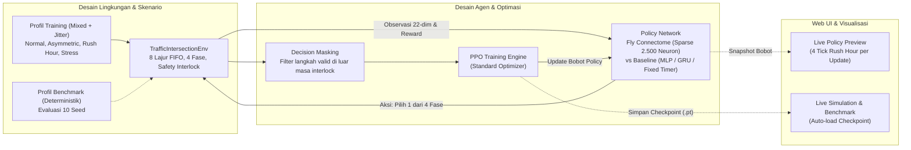
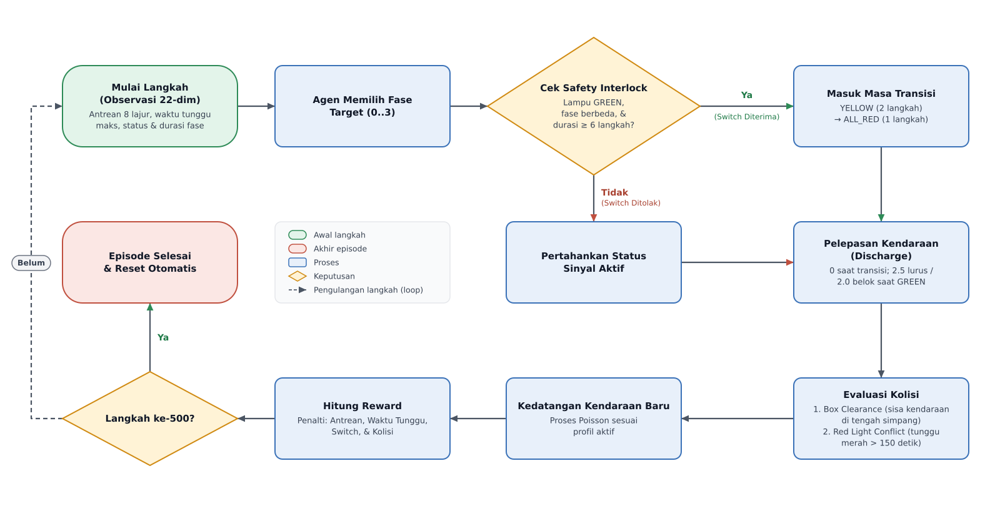
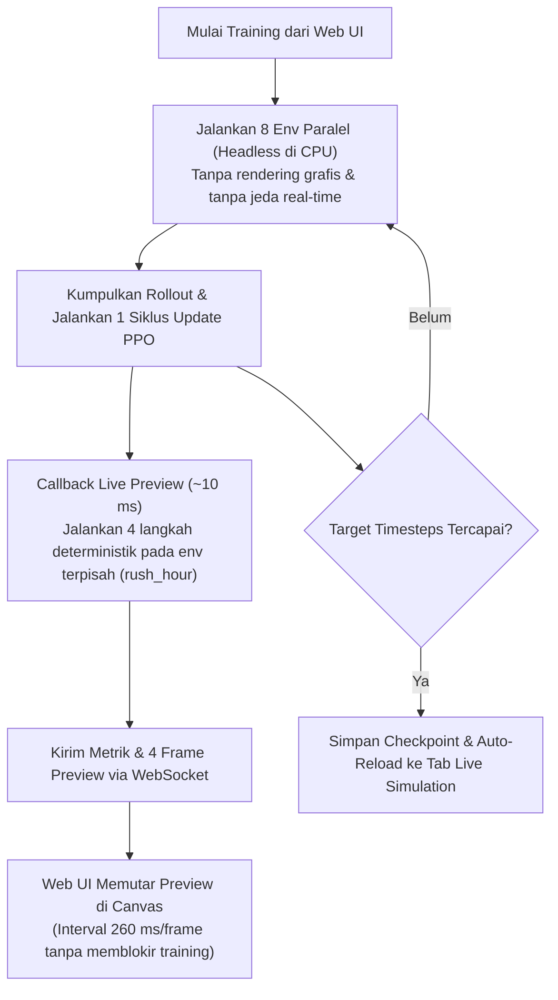

# Arsitektur & Alur Sistem Simulasi Lalu Lintas (Versi Ringkas)

Dokumen ini merangkum desain inti sistem **Fly Traffic**—mencakup lingkungan simulasi, mekanisme *safety interlock*, desain profil lalu lintas, serta integrasi *training* dengan *Live Policy Preview*. Algoritma pembaruan bobot standar (PPO) diperlakukan sebagai mesin optimasi *black-box* sehingga fokus tetap pada komponen yang dirancang khusus dalam proyek ini.

---

## 1. Alur Sistem Keseluruhan (*High-Level Architecture*)

Diagram ini menunjukkan bagaimana skenario lalu lintas, agen kontroler, mesin *training*, dan antarmuka Web UI saling terhubung.

---

## 2. Desain Siklus 1 Langkah Simulasi (`TrafficIntersectionEnv`)

Setiap episode berjalan selama `500` langkah (`1.000` detik simulasi). Flowchart berikut merangkum urutan eksekusi aktual setiap langkah di dalam `TrafficIntersectionEnv`:

---

## 3. Alur *Headless Training* & *Live Policy Preview*

Agar *training* di CPU tetap cepat tanpa terhambat *rendering* visual 60 FPS di browser, sistem memisahkan jalur komputasi *training* dari jalur visualisasi menggunakan mekanisme *preview* ringan.

---

## Ringkasan Poin Desain Utama

| Komponen yang Didesain | Fungsi Utama |
|---|---|
| **Profil Lalu Lintas `mixed`** | Mengacak skenario dan menambahkan *jitter* laju kedatangan agar agen tidak *overfit* pada satu pola kepadatan. |
| **Signal Safety Interlock** | Menegakkan durasi hijau minimum (`6` langkah) serta jeda `YELLOW` dan `ALL_RED` untuk mencegah konflik *box clearance*. |
| **Decision Masking** | Memastikan pembaruan *policy* hanya dihitung pada langkah di mana agen benar-benar diizinkan mengambil keputusan perpindahan fase. |
| **Decoupled Live Preview** | Menjalankan *training* secara *headless* di CPU sambil tetap menampilkan perkembangan perilaku agen secara *live* di browser dengan *overhead* minimal. |